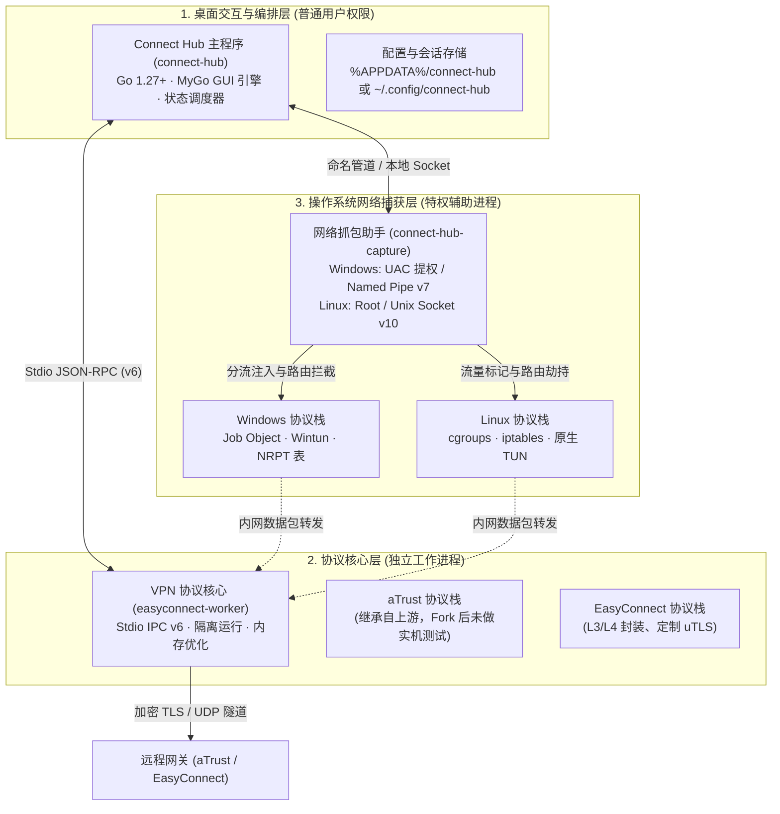

# Connect Hub 开发手册

本手册为 **Connect Hub** 桌面客户端及其底层 VPN 核心、特权网络助手的开发者提供全面的技术架构解析、开发环境搭建指南、本地编译调试方法与测试发布规范。

---

## 目录

1. [架构总览](#1-架构总览)
2. [工作区与多模块拓扑](#2-工作区与多模块拓扑)
3. [核心进程与 IPC 通信规范](#3-核心进程与-ipc-通信规范)
4. [网络模式与底层技术实现](#4-网络模式与底层技术实现)
5. [开发环境与前置依赖](#5-开发环境与前置依赖)
6. [本地构建与调试工作流](#6-本地构建与调试工作流)
7. [测试与自动化验证套件](#7-测试与自动化验证套件)
8. [打包与发布工程化](#8-打包与发布工程化)
9. [高频开发避坑与排错指南](#9-高频开发避坑与排错指南)

---

## 1. 架构总览

Connect Hub 采用现代的**三层解耦与按需提权架构**，杜绝把所有协议和网络控制揉在单个大进程中，保证 GUI 界面的流畅性与系统的稳定性：



### 核心设计原则

1. **协议栈单一真源**：EasyConnect / aTrust 底层协议与特定网络栈（如修改版 uTLS、gVisor）集中在 `zju-connect` 中维护，桌面端通过标准 IPC 驱动，禁止在桌面端随意复制或打补丁。
2. **最小权限与进程边界**：GUI 主程序全程以**普通用户权限**运行；涉及操作系统网络修改（创建虚拟网卡、配置路由、绑定 Job Object、修改系统 DNS）的操作由独立的特权辅助程序（`connect-hub-capture`）在用户授权后执行。
3. **构建上下文严格隔离**：主程序与 Worker 独立编译，禁止混淆 `go.work` 依赖环境。

> [!NOTE] 协议支持现状说明
> 虽然 Connect Hub 完整保留了上游原版所实现的 aTrust 协议代码，但**本分支自上游 Fork 以来尚未针对 aTrust 网关进行实机联调与回归测试**（当前研发与实机验证完全聚焦于 EasyConnect 网关的各网络接管模式）。在 aTrust 相关代码中进行二次开发时需注意潜在未验证的边缘情况。

---

## 2. 工作区与多模块拓扑

根目录下通过 `go.work` 协调开发环境：

```text
easy-connect/
├── aTrustHub/                 # 模块: github.com/ehzyil/connect-hub
├── zju-connect/               # 模块: github.com/mythologyli/zju-connect (独立仓库分支)
│   └── third_party/utls/      # 模块: github.com/refraction-networking/utls (定制版)
├── docs/                      # 架构提案与测试记录
└── go.work                    # 工作区定义
```

### `go.work` 的核心配置逻辑

```go
go 1.27.3

use (
	./aTrustHub
	./tests/e2e
)

// 关键约束：独立 Worker 与 Hub 的 patched aTrust 共享了部分模块路径。
// 在编译或测试 zju-connect 目录内的 easyconnect-worker 时，必须使用 GOWORK=off！

replace (
	github.com/refraction-networking/utls => ./zju-connect/third_party/utls
	inet.af/netaddr => github.com/inetaf/netaddr v0.0.0-20230525184311-b8eac61e914a
)
```

> [!IMPORTANT]
> **切勿把 `./zju-connect` 加入根目录 `go.work` 的 `use` 块中！**
> `zju-connect` 内含针对特定协议握手打过补丁的 `utls` 依赖。若在同一 Go Workspace 中混合解析，会导致构建链接错乱。编译 `zju-connect` 内的代码必须使用 `GOWORK=off`。

---

## 3. 核心进程与 IPC 通信规范

### 3.1 Worker IPC 协议（当前版本：v6）

- **载体**：标准输入输出（`stdin` / `stdout`），以单行 JSON 格式交互。
- **两端代码**：
  - 客户端主程序：[aTrustHub/internal/workeripc/protocol.go](file:///d:/Programming/Projects/Go/easy-connect/aTrustHub/internal/workeripc/protocol.go)
  - Worker 侧：[zju-connect/internal/desktop/protocol.go](file:///d:/Programming/Projects/Go/easy-connect/zju-connect/internal/desktop/protocol.go)
- **协议一致性硬约束**：打包脚本中强制执行 `diff`，两端协议定义必须完全一致。

#### 交互流程：
1. **启动与握手**：主程序拉起 `core/easyconnect-worker`，并监听其 stdout。
2. **连接初始化**：主程序下发 `action: "connect"` 指令，包含目标网关 URL、凭据。
3. **认证挑战回调**：若需要二次认证（动态口令 TOTP、短信验证码 SMS、图形验证码 CAPTCHA），Worker 发送 `challenge` 消息；主程序弹窗提示用户输入后发送 `response` 消息。
4. **状态与通道建立**：认证成功后，Worker 在本地随机端口启动专用回环 SOCKS5 代理服务，并向主程序回复带有随机认证 Token 的接入点信息。
5. **保活与探针**：支持基于空请求/证书探针（`certificate`）与定时 Keepalive 探活。

### 3.2 特权抓包助手 IPC 协议

- **Windows 平台（协议版本：v7）**：
  - 代码位置：[aTrustHub/internal/wincapture/protocol.go](file:///d:/Programming/Projects/Go/easy-connect/aTrustHub/internal/wincapture/protocol.go)
  - **载体**：命名管道（Named Pipe），带有严格受控的 DACL 安全描述符，杜绝任意远程连接。
  - **安全校验**：助手在接受连接时主动校验连接端进程 PID 与可执行文件签名/路径，阻断仿冒攻击；会话 Token 在内存中协商，不写磁盘。
- **Linux 平台（协议版本：v10）**：
  - 代码位置：[aTrustHub/internal/capture/protocol_linux.go](file:///d:/Programming/Projects/Go/easy-connect/aTrustHub/internal/capture/protocol_linux.go)
  - **载体**：Unix Domain Socket（`/run/connect-hub/helper.sock` 或用户专用运行时目录）。
  - **身份凭据**：通过 64 字节随机 Token 进行双向握手确认，防止未授权租约操作。

---

## 4. 网络模式与底层技术实现

Connect Hub 在用户界面（顶栏胶囊下拉菜单与设置页）中将网络接管整合为互斥模式。根据运行平台的能力差异（由 `platform_*.go` 中的 `supportsSystemProxy()` 判定），界面呈现的选项不同：
- **Windows 平台**：呈现 **「不使用」**、**「系统代理」**、**「应用接管」**（若有在线 aTrust 会话且具备 multitun 组件时额外呈现「全局 TUN」）；
- **Linux 平台**：`platform_linux.go` 中 `supportsSystemProxy() = false`，因此界面**严格仅展示「不使用」与「应用接管」**两档，不提供系统代理托管。

底层由以下互补的网络技术栈驱动：

### 4.1 纯本地代理监听（对应「不使用」模式）
- **独立代理端口**：每个成功登录的接入点在本地分配独立的随机或指定端口，方便开发工具（如 DBeaver、VS Code、Git）通过代理插件定向访问特定网关。
- **统一聚合入口**：提供一个统一的本地监听端口，支持智能策略路由：
  - **资源匹配优先**：优先走下发了该目标内网网段/域名的网关。
  - **出口策略**：支持轮询（Round-Robin）、故障转移（Failover）、延迟优先（Latency-First）与源/目标哈希（Hash）。

### 4.2 全局系统代理托管（对应「系统代理」模式）
- 一键将操作系统的全局 HTTP/SOCKS 代理配置指向统一入口端口。
- 具备完善的退出清理与监听自省守护：若统一入口停止监听或客户端退出，自动关闭系统代理，杜绝系统断网。

### 4.3 透明内网路由与进程管控（对应「应用接管」模式）
无需为软件单独配置代理，支持整机内网透明访问与单软件精准拦截：
- **全系统资源路由与域名策略**：
  - Windows：通过特权助手拉起 Wintun 虚拟网卡，仅注入网关私有 IPv4 网段路由（绝不篡改 `0.0.0.0/0`），并通过 NRPT（名称解析策略表）将内网私有域名精准指向网关私有 DNS 解析。
  - Linux：通过原生 TUN 网卡与策略路由表（`ip rule` / `ip route`）维护内网分流。
- **本机软件进程级拦截**：
  - Windows：主程序在拉起软件前创建空 Job Object，并通过 `PROC_THREAD_ATTRIBUTE_JOB_LIST` 在进程创建瞬间原子绑定，利用 `winiphlpapi` 校验进程所有权。
  - Linux：利用 cgroups (net_cls) 打上内部 fwmark 标记，通过策略路由劫持流量。
  - 基于 `winiphlpapi` 的双端端口表比对，校验 TCP 链接的所有者 PID 与进程创建时间，保证只接管属于该 Job 树的流量。
- **Linux 实现**：
  - 基于 **cgroups (net_cls)** 与 `iptables/nftables` 规则，为主程序拉起的应用打上内部 fwmark，通过策略路由重定向至本地 TUN 拦截层。

### 4.3 全系统 TUN 模式（System-wide TUN）
- **Windows（Wintun + NRPT）**：
  - 基于高性能开源驱动 **Wintun**（内置 `sing-tun` + `gVisor` 内存适配栈）。
  - **NRPT（Name Resolution Policy Table）**：将内网专用域名的 DNS 解析规则下发至 Windows NRPT 策略中，实现内网域名精确由网关 DNS 解析，公网域名完全直连。
  - **资源路由注入**：仅针对网关下发的 IPv4 网段注入路由，不篡改系统默认网关（`0.0.0.0/0`），不影响用户正常的公网互联网流量。
- **Linux（Native TUN + Policy Routing）**：
  - 创建系统虚拟网卡并分配内网子网，通过 `ip rule` 与 `ip route` 维护专用路由表。

### 4.4 内存优化与保活自愈机制
- **工作集修剪（Working Set Trimming）**：当客户端最小化或退至托盘超过 30 秒且无活跃流量时，触发系统内存修剪（Windows 调用 `SetProcessWorkingSetSize`，Linux 释放未使用堆并通知内核），将空闲占用降至几十 MB。
- **智能探针**：周期性执行严格的 TCP 端口可达性探测与内网 DNS 解析探测，及时发现网关服务端静默断连并自动触发重连。

---

## 5. 开发环境与前置依赖

### 5.1 基础要求
- **Go 编译器**：Go 1.27.3 或更高版本（必须支持现代构建参数与泛型）。
- **Git**：建议在 Windows 下安装完整的 Git for Windows（包含 Git Bash）。

### 5.2 Windows 平台依赖
- **终端环境**：PowerShell 7 (`pwsh`) 或 Git Bash。
- **安装包生成工具**：[NSIS (Nullsoft Scriptable Install System)](https://nsis.sourceforge.io/)，安装后需确保 `makensis.exe` 在系统环境变量 `PATH` 中。
- **架构支持**：默认构建目标为 `windows/amd64`。

### 5.3 Linux 平台依赖
- **发行版**：Ubuntu 22.04+、Fedora 38+、Arch Linux 等 x86_64 环境。
- **托盘支持库**：
  - Debian/Ubuntu: `sudo apt install libayatana-appindicator3-1`
  - Fedora: `sudo dnf install libayatana-appindicator-gtk3`
  - GNOME 桌面环境需安装并启用 `AppIndicator and KStatusNotifierItem Support` 扩展。

---

## 6. 本地构建与调试工作流

### 6.1 推荐的工作区布局
确保两个仓库在同一工作区目录下保持并列结构：
```text
easy-connect/
├── aTrustHub/       # (分支: dev-main)
└── zju-connect/     # (分支: feat/desktop-worker)
```

### 6.2 Windows 下的本地编译调试（PowerShell 7）

在 `aTrustHub` 目录下执行以下步骤：

```powershell
# 1. 创建本地测试产物目录与内部 core/ 目录
New-Item -ItemType Directory -Force .\build\debug\resources, .\build\debug\core | Out-Null

# 2. 生成带图标的 Windows 资源对象并编译主程序
go run .\cmd\appicon -icon resources\icon.png -arch amd64 -out .\appicon_windows_amd64.syso
go build -mod=readonly -trimpath -ldflags="-H=windowsgui" -o .\build\debug\connect-hub.exe .
Remove-Item .\appicon_windows_amd64.syso

# 3. 编译特权抓包助手
go build -mod=readonly -trimpath -ldflags="-H=windowsgui" -o .\build\debug\core\connect-hub-capture.exe .\cmd\app-helper

# 4. 隔离编译协议核心 easyconnect-worker (必须切换 GOWORK=off)
$prevGoWork = $env:GOWORK
try {
    $env:GOWORK = "off"
    go -C ..\zju-connect build -mod=readonly -trimpath -ldflags="-H=windowsgui" -o ..\aTrustHub\build\debug\core\easyconnect-worker.exe .\cmd\easyconnect-worker
} finally {
    $env:GOWORK = $prevGoWork
}

# 5. 复制资源文件
Copy-Item .\resources\icon.png .\build\debug\resources\icon.png -Force

# 6. 直接运行测试
.\build\debug\connect-hub.exe
```

### 6.3 Linux 下的本地编译调试（Bash）

在 `aTrustHub` 目录下执行：

```bash
# 1. 准备目录
mkdir -p build/debug/resources build/debug/core

# 2. 编译主程序与助手
go build -mod=readonly -trimpath -o build/debug/connect-hub .
go build -mod=readonly -trimpath -o build/debug/core/connect-hub-capture ./cmd/app-helper

# 3. 编译独立 Worker (GOWORK=off)
(cd ../zju-connect && env GOWORK=off go build -mod=readonly -trimpath -o ../aTrustHub/build/debug/core/easyconnect-worker ./cmd/easyconnect-worker)

# 4. 拷贝静态资源
cp resources/icon.png build/debug/resources/

# 5. 运行
./build/debug/connect-hub
```

---

## 7. 测试与自动化验证套件

### 7.1 单元测试与竞态检测
对内部网络栈、认证包、策略包执行测试：

```bash
cd aTrustHub
# 运行单元测试
go test -mod=readonly ./...

# 针对高频通信包运行竞态检测 (-race)
go test -race ./internal/workeripc ./internal/vpn
```

### 7.2 核心组件通信一致性检查
打包或提交前，确保两端的协议定义文件完全一致：

```bash
diff -u <(sed -e 's/\r$//' -e 's/^package desktop$/package workeripc/' ../zju-connect/internal/desktop/protocol.go) \
        <(sed 's/\r$//' ./internal/workeripc/protocol.go)
```

### 7.3 助手与核心协议版本校验
```bash
# 校验 Windows 助手协议版本 (当前预期为 7)
./core/connect-hub-capture.exe --protocol-version

# 校验 Linux 助手协议版本 (当前预期为 10)
./core/connect-hub-capture --protocol-version
```

---

## 8. 打包与发布工程化

Connect Hub 提供全自动的打包脚本，分别生成便携包与安装程序。

### 8.1 Windows 打包 (`package-windows.sh` & NSIS)
Windows 打包脚本位于 `aTrustHub/scripts/package-windows.sh`：

```bash
cd aTrustHub
# 生成标准 Release 便携包 (connect-hub-windows-amd64.zip)
bash ./scripts/package-windows.sh

# 生成 Windows 安装向导 (connect-hub-setup-windows-amd64.exe)
go run ./cmd/appicon -ico resources/icon.ico
makensis packaging/windows/installer.nsi
```

产物存放于 `aTrustHub/build/`：
- `connect-hub-windows-amd64.zip`：绿色便携包。
- `connect-hub-setup-windows-amd64.exe`：一键安装程序。

### 8.2 Linux 打包 (`package-linux.sh`)
Linux 打包脚本位于 `aTrustHub/scripts/package-linux.sh`：

```bash
cd aTrustHub
bash ./scripts/package-linux.sh
```

产物存放于 `aTrustHub/build/`：
- `connect-hub-linux-amd64.tar.gz`：包含主程序、`core/` 助手与 Worker、多分辨率图标及 `.desktop` 安装脚本。

### 8.3 CI/CD 工作流
GitHub Actions 自动化流水线配置在 [aTrustHub/.github/workflows/build.yml](file:///d:/Programming/Projects/Go/easy-connect/aTrustHub/.github/workflows/build.yml)：
- 支持推送 `v*` 标签或手动 `workflow_dispatch` 触发。
- 在 Windows 环境下通过 Chocolatey 自动安装 NSIS 并编译生成 Setup 安装器。
- 自动汇集双平台构建产物并发布 GitHub Release。

---

## 9. 高频开发避坑与排错指南

### 1. `easyconnect-worker` 报错缺少特定 `utls` 符号
- **原因**：在编译 worker 时误加载了根目录的 `go.work`，导致引用了标准版本的 `utls` 而非特定补丁版。
- **对策**：在编译或测试 `zju-connect` 相关代码时，必须显式附加 `GOWORK=off` 环境变量。

### 2. 界面报错「缺少 easyconnect-worker 核心」
- **原因**：程序在当前运行路径、可执行文件所在同级目录及 `core/` 子目录下均未找到 `easyconnect-worker(.exe)`。
- **对策**：检查构建目录结构，确保内部程序放置在 `core/` 下；本地调试时可通过环境变量指定：
  ```bash
  export EASYCONNECT_WORKER=/path/to/easyconnect-worker
  ```

### 3. Windows 提示「网络助手版本不匹配（需要协议 v7）」
- **原因**：升级了主程序，但运行目录下的 `core/connect-hub-capture.exe` 仍为旧版本编译产物。
- **对策**：必须同时重新编译主程序与 `cmd/app-helper`，二者配套分发。

### 4. 退出后发现 DNS 解析异常或遗留虚拟网卡
- **对策**：Connect Hub 内部实现了多重安全回收保障（Heartbeat 租约超时注销、进程退出信号捕获及 HKLM 故障恢复日志）。如果开发期间被 IDE 强行 Kill：
  - Windows：在管理员 PowerShell 中执行：
    ```powershell
    Get-DnsClientNrptRule | Where-Object { $_.Comment -like "*ConnectHub*" } | Remove-DnsClientNrptRule -Force
    ```
  - Linux：执行 `sudo systemctl stop connect-hub-helper` 或清理 `/run/connect-hub/`。
