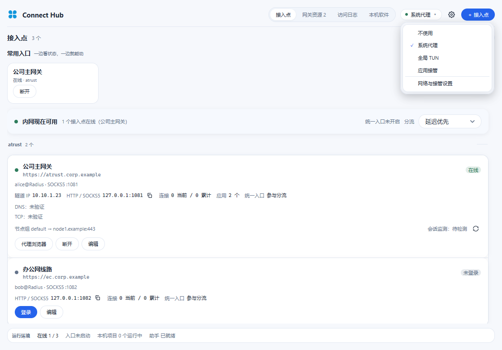

# Connect Hub (桌面端)

[](https://github.com/ehzyil/aTrustHub/actions/workflows/build.yml)
[](LICENSE)
[](https://go.dev/)
[](https://github.com/ehzyil/aTrustHub/releases)

**Connect Hub**（原 aTrustHub）是聚合多套企业/高校 VPN 接入点的跨平台桌面客户端，支持在一个窗口内**同时登录并保持多个深信服 aTrust 零信任网关与 EasyConnect VPN 接入点**，并按资源归属实现智能分流。

> [!NOTE] 文档说明与免责声明
> 本项目的说明文档与开发手册主要由 **AI 辅助分析与整理生成**。**若文档表述与程序实际运行逻辑、代码实现存在细微出入或更新滞后，请一律以最新源代码（Source Code）及实际运行时表现为主**。欢迎提交 PR 协助修正文档。

---

## 核心特性

- **默认简单模式**：全新安装的首屏只有一张连接卡和一个内网网址输入框，专业设置收进设置页；设置页里关掉「简单模式」即回到完整模式的四个分页。已经存过完整模式设置的配置在升级后保持原样。
- **多网关并发**：同时连接多个不同单位/客户的 aTrust 或 EasyConnect 网关，互不干扰，隧道独立（*注：aTrust 为上游原有实现，本分支 Fork 后未进行实机测试*）。
- **全认证支持**：账号密码、企业微信扫码/客户端确认、短信验证码、图形验证码及浏览器第三方 SSO（CAS / IDaaS）。
- **按需网络接管**：
  - **Windows 平台**：支持「不使用」（纯本地监听）、「系统代理」（全局系统代理托管）与「应用接管」（Wintun 驱动与私有网段/NRPT 路由，透明访问内网）三种互斥模式；
  - **Linux 平台**：支持「不使用」（纯本地监听）与「应用接管」（Linux 原生 TUN 资源路由与 cgroup 流量管控），Linux 平台不提供系统代理托管；
  - **独立与统一入口**：每个在线接入点提供独立 SOCKS5 端口，同时提供具备故障转移、延迟优先与哈希策略的统一聚合入口。
- **证书指纹核验**：针对自签名或格式异常的网关证书，提供安全的 SHA-256 指纹核验与信任绑定。
- **自愈与资源保障**：周期保活（Keepalive）、失效自动重连、健康度探测与退出完全清理，杜绝网络垃圾残留。
- **内存深度优化**：支持后台闲置工作集修剪（Working Set Trimming），显著降低空闲常驻内存占用。
- **局域网分享与自动发现**：把本机已登录的网关资源分享给同一网段的同事——口令里带 256 位分享令牌与证书指纹，加入仍需该口令（广播里的信息不构成授权）；可选开启 DNS-SD 自动发现，让同事在列表里看到分享名称与地址。分享只转发网关授权的资源，公网仍走同事自己的网络。**测试状态**：Windows/Linux 已完成同机回环与真实内网访问验证；跨机发现、Windows 防火墙入站 5353 仍待实机确认（见 [design/lan-relay-discovery-2026-11-24.md](docs/design/lan-relay-discovery-2026-11-24.md) §9、§19.1）。

> [!WARNING] 协议支持与测试状态说明
> 本项目代码库继承并保留了上游原版对 **深信服 aTrust 零信任网关** 的完整支持代码。但自当前分支从上游 Fork 以来，所有功能迭代与实机验证均集中在 **EasyConnect 网关**、软件抓包接管与全系统 TUN 模式上，**aTrust 协议在当前分支未做实机回归测试**。使用 aTrust 时若遇到问题，欢迎提交反馈。

---

## 软件功能界面展示

### 1. 多接入点管理主界面
一个窗口统一管理多网关，实时展示连接状态、延迟与独立代理端口：


### 2. 顶栏接管模式快速切换
直观的顶栏胶囊下拉菜单，可在 **「不使用」**、**「系统代理」**、**「应用接管」** 间就地切换：


### 3. 本机软件接管（进程级定向分流）
将特定工具关联至指定网关，免配代理直接互通：


### 4. 网关资源与私有网段
直观呈现下发的网段资源并支持一键连通性测试：


---

## 相关文档索引

- 开发者完整手册：[DEVELOPMENT.md](docs/DEVELOPMENT.md)
- Windows 快速入门手册：[WINDOWS-QUICKSTART.md](docs/WINDOWS-QUICKSTART.md)
- Linux 快速入门手册：[LINUX-QUICKSTART.md](docs/LINUX-QUICKSTART.md)
- Windows 底层技术实现白皮书：[WINDOWS-IMPLEMENTATION.md](docs/WINDOWS-IMPLEMENTATION.md)
- 局域网分享（协议、生命周期、严格出口边界）：[docs/design/lan-relay-sharing-implementation-2026-11-24.md](docs/design/lan-relay-sharing-implementation-2026-11-24.md)
- 局域网分享自动发现（DNS-SD、缓存上限、复审与实测记录）：[docs/design/lan-relay-discovery-2026-11-24.md](docs/design/lan-relay-discovery-2026-11-24.md)
- 旧文档勘误（哪些旧说法已与代码不符）：[docs/review/errata.md](docs/review/errata.md)
- 历史设计稿与架构演进记录：[组件边界重构方案](docs/plans/component-boundaries-2026-11-26.md)

---

## 本地编译与运行简述

桌面启动入口在 `cmd/connect-hub`，窗口、页面与装配在 `internal/desktop`；
清理任务和资源接管控制器分别在 `internal/cleanup/client`、`internal/localapps/takeover`。
根目录只保留模块与构建配置，所有下列命令均从根目录执行。

详细编译环境配置与调试流程，请查阅 **[DEVELOPMENT.md](docs/DEVELOPMENT.md)**。

安装 `packaging/build-inputs.json` 指定的 Go 版本后，在产品仓库执行：

```bash
git submodule update --init --recursive
bash scripts/build.sh -development
# 输出 build/debug/connect-hub 与 core/ 配套组件。
```

---

## 开源协议

本项目遵循 [AGPL-3.0 License](LICENSE) 协议。
