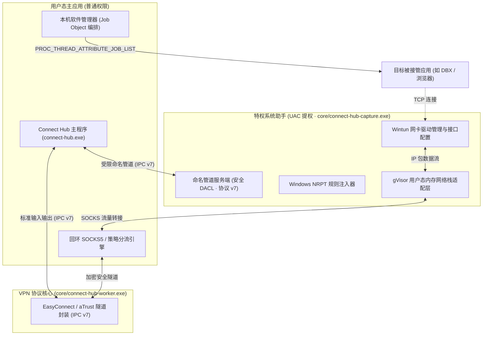

# Connect Hub · Windows 平台底层技术实现白皮书

本文档系统阐述 **Connect Hub** 在 Windows 操作系统下的网络底层架构设计、特权进程安全隔离、进程级流量拦截（Job Object）、Wintun 虚拟网卡驱动集成、NRPT（名称解析策略表）注入及异常恢复保障机制。

---

## 1. 架构与进程边界设计

Windows 平台网络底层采用**主程序（普通权限）+ 特权助手（UAC 提权）+ 协议工作进程（独立隔离）**的三进程模型：



---

## 2. 进程启动屏障与 Job Object 生命周期管控

在“本机软件接管”模式下，为了精准且无泄漏地拦截特定应用的流量，Connect Hub 实现了严格的**进程启动屏障（Launch Barrier）**：

1. **预先保留 Job Object**：主程序在调用 `CreateProcess` 创建目标应用前，先在普通权限下创建一个空的 Windows Job Object，并将其预注册到网络助手的监控会话中。
2. **原子绑定（Atomic Job Assignment）**：
   - 使用 Windows Vista+ 引入的扩展进程创建属性：`PROC_THREAD_ATTRIBUTE_JOB_LIST`。
   - 在 `CreateProcessW` 执行的瞬间，目标进程及其未来衍生出的所有子进程被操作系统原子地加入该 Job Object。
   - **杜绝悬挂孤儿进程**：避免了旧方案中“先以挂起状态（`CREATE_SUSPENDED`）创建进程、再挂接 Job、随后恢复运行”模式下因主程序异常崩溃导致的孤儿进程滞留。
3. **非破坏性脱钩（Non-destructive Detach）**：
   - Connect Hub 停止软件接管或主动退出时，仅注销网络拦截与端口重定向，**绝不强杀（Terminate）**用户正在运行的目标软件及其子进程。
   - 目标软件及其子进程在脱钩后自动平滑回退至操作系统的直连网络。

---

## 3. TCP 端口所有权校验与多接口分流

助手对捕获到的每一条 TCP 流量进行严格的身份验证，杜绝误拦截系统其他进程的流量：

1. **双端匹配校验**：
   - 利用 `winiphlpapi`（Windows IP Helper API）中的 `GetExtendedTcpTable` 读取当前系统的活动连接状态表。
   - 校验源 IP/端口与目的 IP/端口，获取对应的进程 PID。
2. **进程所有权与创建时间防伪**：
   - 打开该 PID 的进程句柄，比对进程所属的用户 SID 以及**进程创建时间（Creation Time）**，防止 PID 重用（PID Recycling）导致的身份仿冒。
   - 校验该进程是否确实属于预先登记的 Job Object 树。
3. **模糊所有权拒绝（Ambiguity Rejection）**：
   - 凡是所有权未知、处于过渡状态或存在二义性的连接，一律予以拒绝或放行原路径，不进行盲目劫持。
   - 未选中的应用在访问相同目标时，根据路由表走物理网卡或第三方网卡（如 Tailscale）直连。

---

## 4. 特权助手 IPC 通信与安全防御

特权助手 `connect-hub-capture.exe` 承担创建虚拟网卡和注入路由的系统级操作，其 IPC 接口（协议版本：**v7**）具备严密的安全防御措施：

- **受限命名管道（Restricted Named Pipe）**：
  - 管道路径：`\\.\pipe\connect-hub-capture-<SESSION_ID>`。
  - 配置显式安全描述符（DACL），仅允许当前操作系统用户与 `SYSTEM` 账户访问，禁止跨用户访问，**明确拒绝网络远程客户端**。
- **调用者身份校验**：
  - 助手通过 `GetNamedPipeClientProcessId` 获取调用者 PID。
  - 检查调用者可执行文件路径与主程序完全匹配，杜绝本地其他恶意进程调用特权助手。
- **凭据零磁盘泄露**：
  - 会话 Token、SOCKS 代理私有凭据全程仅通过命名管道在内存中传输协商，不落磁盘、不经过命令行参数，防范进程命令行扫描泄露。

---

## 5. Wintun 网卡驱动与内存网络栈适配

在“全系统 TUN 模式”下，Connect Hub 深度集成了高性能驱动 **Wintun**：

### 5.1 驱动与接口初始化
- 选用经过广泛验证的 Wintun 0.14.1 官方稳定二进制。
- 通过 `sing-tun` 实现 Wintun 适配器的动态安装、配置与卸载。
- **IPv4 接口参数严格标准化**：
  - 调用 `SetIpInterfaceEntry` 写回接口属性前，必须强制将 `SitePrefixLength` 清零（符合 Microsoft 官方 Win32 API 规范，彻底解决了早期版本因未清零导致的“参数不正确”报错）。

### 5.2 用户态网络栈（gVisor Netstack）
- 引入经过深度裁剪与兼容性适配的 `metacubex/gvisor` 用户态 TCP/IP 协议栈。
- 通过 Channel Endpoint 接收 Wintun 捕获的原始 L3 IP 数据包，并在用户态完成 TCP 握手重组，最终桥接至本地 SOCKS5 代理。
- 无需修改 Windows 内核防火墙规则，杜绝因第三方安全软件拦截防火墙修改而引发的安装失败。

---

## 6. 路由注入与 NRPT 域名策略编排

### 6.1 精确资源路由（Resource Routing）
- **绝不篡改默认网关**：Connect Hub 不向系统路由表写入 `0.0.0.0/0` 默认路由，彻底杜绝 VPN 抢占全网流量导致公网变慢、内网外网冲突的问题。
- **精确网段路由**：仅将接入点网关下发的私有内网 IP 网段（单次配置最多支持 1,048,576 个 IP 地址）路由绑定至 Wintun 接口。
- **冲突防范**：启动前执行路由冲突检测，遇到等长或更具体的已有外部路由时明确拒绝启动并告警，防止路由黑洞。

### 6.2 NRPT（Name Resolution Policy Table）策略注入
- 通过 Windows NRPT 机制，为网关对应的内网私有顶级域名/子域名（如 `*.corp.internal`）下发专用 DNS 解析策略。
- 当应用程序发起域名查询时，Windows DNS 客户端自动根据 NRPT 规则将内网域名送往网关 DNS 服务器解析，外网域名依然走本地物理网卡 DNS，实现真正的**无感混合分流**。

---

## 7. 异常崩溃恢复与看门狗守卫机制

网络底层配置最忌讳“程序异常退出后遗留垃圾网卡与路由，导致用户断网”。Connect Hub 构建了闭环的清理保障系统：

1. **租约与心跳机制（Heartbeat Lease）**：
   - 主程序与特权助手保持实时心跳探测。
   - 若主程序异常崩溃或被任务管理器强行结束，助手在租约超时后自动触发回滚流程。
2. **看门狗与注册表恢复日志（HKLM Journal）**：
   - 特权助手在修改系统网络栈前，在系统注册表（`HKLM\Software\ConnectHub`）记录微量且关键的会话元数据（助手 PID、启动时间戳、已注入的 NRPT 策略标识）。
   - 系统重启或异常断电恢复后，下一次运行的特权助手会自动扫描该注册表项，清理因掉电遗留的无效 NRPT 规则与虚拟网卡，彻底恢复操作系统网络原貌。
3. **主动逆向回滚**：
   - 停止接管时，按“注销 NRPT → 撤回路由 → 销毁 Wintun 接口 → 释放管道会话”的严格逆序执行。

---

## 8. 本机自测与 Win32 诊断

开发与发布包附带了 `test-capture.ps1`，支持在无需真实提权和外网 VPN 的环境下，全自动验证上述机制：

```powershell
pwsh -NoProfile -ExecutionPolicy Bypass -File .\test-capture.ps1
```

- **验证范围**：
  - Worker IPC v7 单行 JSON 协议一致性；
  - Job Object 原子创建与子进程跟踪；
  - `winiphlpapi` TCP 状态表所有权判定与二义性剔除；
  - SOCKS 握手重组、数据完整性与 TCP 半关闭（Half-Close）传输；
  - 助手管道协议 v7 帧解析与边界超时控制；
  - 异常取消后的资源差量回滚与 HKLM 日志写入。
- **诊断信息**：所有底层 Win32 API 报错均携带详细的上下文操作名称与标准十六进制 Win32 错误代码（如 `0x5` 拒绝访问、`0x57` 无效参数等），便于快速定位现场故障。
