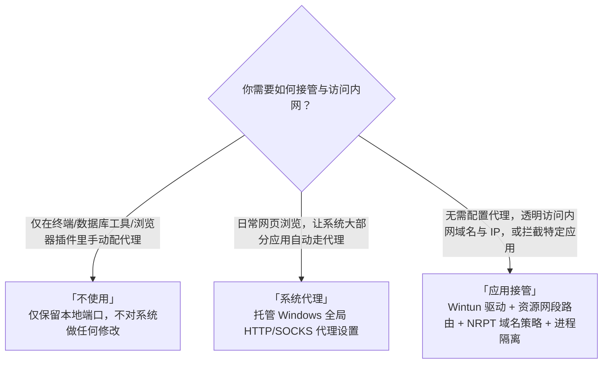

# Connect Hub · Windows 用户快速入门手册

欢迎使用 **Connect Hub**！本手册介绍 Windows 平台下的安装部署、多网关添加与登录、三种网络接管模式的选择与配置，以及常见故障排查。

---

## 1. 版本与运行环境要求

- **操作系统**：Windows 10 / Windows 11（64 位，x86_64 / amd64）
- **权限要求**：
  - **基础代理与日常使用**：普通用户权限即可运行。
  - **软件进程接管 / 全系统 TUN 模式**：需要 Windows UAC 管理员授权（用于初始化 Wintun 驱动与注入 NRPT 域名策略，日常数据传输仍在低权限下进行）。

---

## 2. 安装与目录结构

Connect Hub 在 Windows 平台提供两种分发形式：

### 2.1 安装包版本（推荐）
下载 `connect-hub-setup-windows-amd64.exe` 并运行：
1. 默认安装路径为当前用户的应用程序目录：`%LOCALAPPDATA%\Programs\ConnectHub`（无需管理员权限即可安装）。
2. 自动创建桌面快捷方式与开始菜单入口。
3. 可以在 Windows「设置」→「应用」→「安装的应用」中随时一键完整卸载。

### 2.2 便携版（绿色解压即用）
下载 `connect-hub-windows-amd64.zip`：
1. 将压缩包**完整解压**到任意本地目录（例如 `D:\Tools\ConnectHub\`）。
2. **切勿只单独复制单个 EXE**。应用程序依赖 `core/` 目录下的内部核心组件：
   ```text
   ConnectHub/
   ├── connect-hub.exe              # 主程序（双击运行此文件）
   ├── core/
   │   ├── easyconnect-worker.exe   # VPN 协议处理引擎
   │   └── connect-hub-capture.exe  # 操作系统网络与抓包助手
   ├── resources/                   # 图标与界面资源
   ├── LICENSES/                    # 开源许可说明
   └── README.md                    # 本手册
   ```
3. 双击根目录下的 `connect-hub.exe` 启动程序。

---

## 3. 接入点添加与登录

Connect Hub 支持同时登录多个不同单位的网关：

### 3.1 添加网关
在主界面左侧点击 **「添加接入点」**：
- **接入点名称**：便于识别的备注名称（如“公司办公网”、“高校校园网”）。
- **网关协议**：按实际网关类型选择 **深信服 aTrust** 或 **深信服 EasyConnect**（*注：aTrust 继承自上游实现，本分支 Fork 后未进行实机测试，日常测试以 EasyConnect 为主*）。
- **服务器地址**：网关的域名或 IP 地址及端口（如 `vpn.example.com:443`）。

### 3.2 身份认证方式
根据网关配置，Connect Hub 支持以下认证组合：
- **账号密码**：输入用户名与密码。可选填登录域（Domain）或 6 位 TOTP 动态口令。
- **短信验证码 (SMS) / 图形验证码 (CAPTCHA)**：若网关开启二次验证，登录时会弹出专属原生对话框提示输入。
- **企业微信认证**：选择后将弹出专属二维码窗口，支持手机企业微信扫码或电脑端直接点击确认。
- **第三方单点登录 (SSO / CAS / IDaaS)**：点击登录后将通过独立的隔离浏览器完成登录，主程序自动捕获会话 Cookie 并建立安全隧道。

### 3.3 网关证书安全检查
部分自建网关证书可能存在自签名、域名不匹配或异常 SAN 字段。当出现“网关证书格式不兼容”提示时：
1. 点击错误卡片上的 **「查看网关证书」**。
2. 程序会通过安全探测读取并计算该网关 TLS 证书的 SHA-256 指纹。
3. 确认指纹来源可信后，勾选 **「我已核实网关来源，信任此证书」** 即可安全建立连接。

---

## 4. 三大接管模式详解与选型指南

在窗口顶栏的**接管胶囊下拉菜单**（或在「设置」→「网络与接管」页面中），Connect Hub 提供了三种互斥的流量接管方式：



### 4.1 「不使用」（仅本地监听）
- **适用场景**：日常开发、命令行工具（curl / Git）、数据库管理软件（DBeaver / Navicat / DataGrip）或配合浏览器代理插件（如 SwitchyOmega）使用。
- **运行机制**：
  - Connect Hub 不对操作系统的网络栈、系统代理和路由表做任何修改，最纯净、零提权。
  - 每个在线接入点在本地开放独立的专属 SOCKS5 端口。
  - 启动一个**统一入口端口**（支持基于资源网段归属的智能分流，以及故障转移、延迟优先、轮询、哈希策略）。
  - 用户只需在目标工具的代理设置中填入 `127.0.0.1:<端口号>` 即可。

### 4.2 「系统代理」（全局系统代理托管）
- **适用场景**：日常办公网页浏览、系统自带组件及遵循 Windows 系统代理的通用桌面软件。
- **运行机制**：
  - 自动将 Windows 系统的网络代理（即 Windows「设置」→「网络和 Internet」→「代理」）指向 Connect Hub 的统一入口端口。
  - 所有遵循系统代理的应用流量均会自动走统一入口并由网关转发。
  - **安全自愈与防断网保护**：若统一入口异常停止或客户端退出，程序会自动关闭系统代理，绝不会将系统留在失效的代理配置下导致断网。

### 4.3 「应用接管」（内网透明接管 / 本机软件管控）
- **适用场景**：客户端无法配置代理、内网应用绑定了固定私有域名/IP，或需要精准拦截特定进程发起的流量。
- **运行机制**：
  - **内网资源路由与透明访问**：基于特权助手与 Wintun 驱动，向系统注入网关下发的私有 IPv4 网段路由，并通过 Windows NRPT（名称解析策略表）精准下发内网私有域名的 DNS 解析规则。**不修改系统默认网关（0.0.0.0/0）**，公网访问完全保持本地原有速度与路径。
  - **本机软件精准管控**：在主界面「本机软件」中添加并启动目标软件，通过 Windows 原生 Job Object 原子绑定与端口所有权验证，仅拦截该软件进程树发出的流量，其他软件完全不受影响。
  - **自动恢复机制**：在「设置」中可开启「启动 / 登录后自动恢复应用接管」，无需每次手动重连。

> [!NOTE] 关于「全局 TUN」选项
> 若配置中存在已登录的深信服 aTrust 接入点，且系统部署了提权组件，下拉菜单中可能会额外显示历史保留的 **「全局 TUN」** 选项。该选项仅专用于 aTrust 会话；对于 EasyConnect 网关，透明无感接入完全由 **「应用接管」** 负责。

---

## 5. 常见问题排查与维护

### Q1：切换至「应用接管」或启动被接管软件时弹出 Windows UAC 提示？
**解答**：正常现象。创建 Wintun 虚拟网卡与配置系统 NRPT 路由表属于 Windows 受保护的网络底层操作，必须通过系统管理员授权。授权后辅助进程仅处理网络规则，不会修改用户其他系统设置。

### Q2：退出 Connect Hub 后，内网访问是否会有残留影响？
**解答**：Connect Hub 具备严格的清理与看门狗保障机制：
- 正常退出时，自动注销 NRPT 规则、卸载虚拟网卡、恢复系统代理设置。
- 即使主程序异常终止，后台辅助服务在租约心跳超时后也会自动回滚所有网络配置。

### Q3：如何最小化到系统托盘并节省系统资源？
**解答**：
- 点击主窗口右上角关闭按钮，默认最小化到任务栏通知区（系统托盘）后台运行。
- 在设置中开启后，当客户端在后台静默超过 30 秒且无流量时，会自动触发内存工作集修剪，内存占用将大幅缩减。
- 如需彻底退出程序，请右键托盘图标选择 **「退出」**。

### Q4：自测诊断脚本如何使用？
如果在使用过程中遇到异常，可以在普通权限 PowerShell 中运行安装包附带的自测脚本：
```powershell
pwsh -NoProfile -ExecutionPolicy Bypass -File .\test-capture.ps1
```
该脚本在纯内存与本地回环环境下验证所有 IPC 通信与网络栈逻辑，并将结果输出到 `capture-selftest.txt` 供排查分析。
