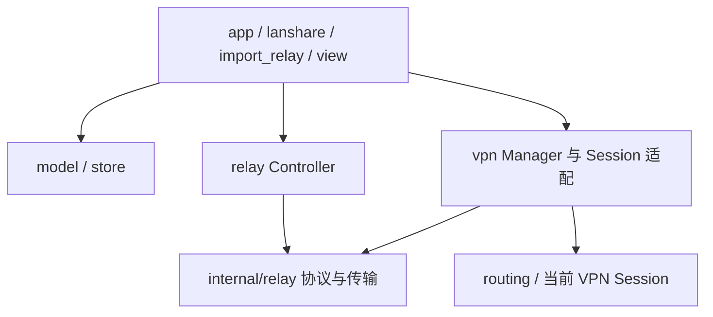
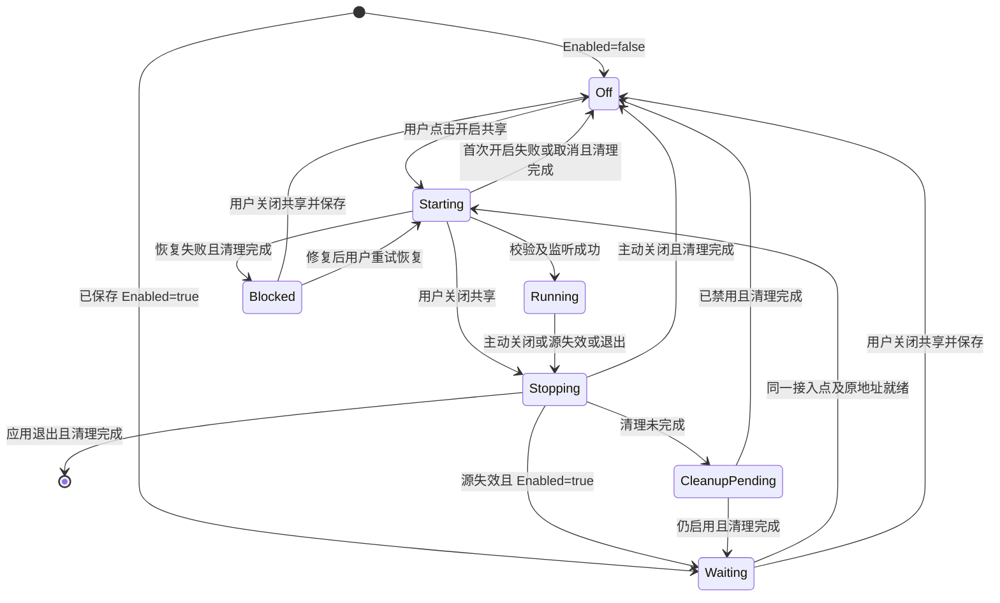

# 局域网分享：详细实现方案

日期：2026-11-24。源码核对基线：`aTrustHub` 提交 `f3f7cf92a52f`（已在实现前核对：当时 `dev-main` 的 HEAD 正是该提交，工作区干净）。实现分支：`feat/lan-relay-sharing`。状态：**T01–T10 已实现，未做跨机实机验收**。

本文将 [需求分析与 UI/UX 计划](lan-relay-sharing-plan-2026-11-24.md) 细化为开发契约，并记录实现与验证结果。仓库路径除特别说明外均相对 `aTrustHub/`。

## 1. 已固定的产品约束

1. 产品名称及入口保持“局域网分享”；启停操作使用“开启共享”“关闭共享”，管理操作使用“管理共享”“复制分享口令”。
2. A 的共享首次安装及旧配置升级默认关闭。只有用户点击“开启共享”才将启用意图持久化；此后应用重启自动恢复，直到用户明确点击“关闭共享”。自动恢复沿用已授权的启用意图，不要求每次重启再次开启；这不等于新增应用开机启动设置。
3. 打开配置面板、保存草稿、B 导入节点均不启用共享、不修改已有监听地址。应用启动只在已保存 `Enabled=true` 且前置条件满足时恢复独立共享服务。
4. 共享范围以整个接入点为单位，不新增资源勾选、资源子集、分享专用端口/域名白名单或逐资源授权。首版同时只启用一个本机 VPN 接入点；不允许选择 `lan_relay` 或已移交旧全局 TUN 的会话。原接入点已有授权和停用策略仍生效，资源变化随接入点自动同步。
5. B 只把已发布、已授权的资源交给 A；未被资源声明命中的普通公网目标在 B 直连。资源可使用公网 IP，不能用“是否私网”代替资源归属。
6. A 对分享请求只提供指定 VPN 的严格出口，未知目标、未授权端口和 `direct` 决策均拒绝，不提供 A 物理网卡的公网出口。
7. 首版协议仅提供 TCP 连接；不声明 UDP、ICMP、透明全机接管、跨网穿透、手机原生代理或免客户端接入。
8. B 添加并连接不隐式改变系统代理；导入节点的 `AutoConnect=false`。主机分享、B 连接、剪贴板识别、系统代理为独立行为。
9. 剪贴板自动识别默认关闭；未选择开启时，启动和聚焦都不读取剪贴板。
10. A 的绑定 VPN 断开/重登、LAN 地址消失或真正退出时，停止运行实例并终止旧连接，但不清除启用意图。重启/恢复后仅对同一接入点重新校验并取得新源；离线时显示“共享已启用，等待接入点连接”，不借共享功能静默登录 VPN，不自动改选其他接入点、网卡或地址。
11. 用户“关闭共享”同时清除持久化启用意图、撤销口令、终止新请求/待处理拨号/已有业务连接。随后再次手动开启生成新 ID、凭据及证书；普通应用重启则复用已保存身份和地址端口，旧口令在校验通过后继续可用。异常恢复失败显示待处理原因，不伪报正在运行。
12. “已知资源不自动回落直连”适用于经过 B 本地入口且已取得归属的目标；不能承诺识别尚未同步的新增资源，也不能覆盖绕过代理的软件。

## 2. 模块边界及依赖



`internal/relay` 只承载 LAN 协议、TLS、网络候选、客户端和服务端生命周期，使用标准库及小型必要依赖。它不导入 `internal/vpn`、`internal/model` 或 GUI 包；资源 DTO 在 relay 包独立定义，由 vpn 适配层转换，避免环形依赖及误把本地 worker IPC 暴露到 LAN。

| 组件 | 职责 | 明确不负责 |
| --- | --- | --- |
| `relay.Controller` | A 的启用意图协调、启动恢复/暂停/关闭状态机、源会话观察、有效口令和运行视图 | 修改系统代理、自动登录 VPN |
| `relay.Server` | TLS、认证、控制会话、CONNECT、限流、连接清理 | 猜测 VPN 授权、调用系统直连兜底 |
| `vpn` 中的分享源适配 | 锁定 endpoint 身份/代次，输出有效规则，严格拨号和 DNS | 在 HTTP handler 中持 Manager 锁等待网络 |
| `relay.Client` | 固定身份的控制请求、CONNECT、状态轮询、类型化错误 | 持久化账号、修改 GUI |
| `vpn.relaySession` | 实现 Session 等接口、转换资源、传播失效 | 启动外部 worker 或调用 aTrust 登录 |
| `app` | 注入依赖、持久化共享设置/身份、启动恢复、UI 线程调度、退出顺序 | 在绘制函数内启动 goroutine/监听 |

## 3. 配置、凭据与迁移

### 3.1 拟新增模型

以下为字段规格，代码示意省略已有字段。

```go
type RelayPointOptions struct {
	Version            int    `json:"version"`
	ShareID            string `json:"shareId"`
	CertificateSHA256  string `json:"certificateSHA256"`
	HistoryInitialized bool   `json:"historyInitialized,omitempty"`
}

type LANShareSettings struct {
	Enabled           bool   `json:"enabled"`
	PointID           string `json:"pointId,omitempty"`
	InterfaceName     string `json:"interfaceName,omitempty"`
	PreferredIPv4     string `json:"preferredIPv4,omitempty"`
	Port              int    `json:"port,omitempty"` // 0 = 首次开启时自动分配
	BoundPort         int    `json:"boundPort,omitempty"`
	ShareID           string `json:"shareId,omitempty"`
	CertificateSHA256 string `json:"certificateSHA256,omitempty"`
}
```

- `AccessPoint` 增加 `Relay *RelayPointOptions`，增加 `ProtocolLANRelay = "lan_relay"`。
- 仍用 `Server` 保存纯 IPv4、`Port` 保存真实端口；不得把 `IP:Port` 整体保存进 `Server`。
- `Settings` 增加 `LANShare LANShareSettings` 和 `RelayClipboardDetection bool`，两者启用标记缺省均为 false。
- **持久化 `LANShare.Enabled` 表示用户启用意图，不持久化 `Running`**。`Enabled=true` 可以对应 Waiting/Starting/Running/Blocked；是否实际监听由 Controller 运行视图给出。首版设置只保存一个 PointID，不保存 ResourceIDs 或分享专用资源筛选字段。
- `BoundPort` 保存首次成功分配的实际端口，恢复时复用；`ShareID`/指纹引用 A 的持久化身份。Enabled=true 却缺少合法接入点、身份或已绑定地址端口时进入 Blocked，不生成替代身份后静默监听。
- `Username`、`AuthMode`、`LoginDomain`、TOTP、SSO 等 VPN 登录字段对 relay 不适用；按协议提前分支，不使用虚构用户名通过通用校验。
- 导入默认 `InPool=true`、`SocksPort=0`、`AutoConnect=false`、`Monitor=false`。现有统一入口不改变端口；是否启用系统代理保持用户原状态。

### 3.2 Normalize / Validate / Clone

- `AccessPoint.Normalize/Validate` 先识别 relay：版本必须为 1，分享 ID 为指定编码的 128 位随机 ID，指纹为 64 位十六进制 SHA-256，IPv4 及端口符合 §4。
- relay 不进入 aTrust 默认 `Radius` 和登录模式补全分支；非 relay 不允许携带 Relay 元数据。
- `Config.Clone` 深拷贝新增指针；`Settings.Clone` 随新增类型保持值语义。`needsRestart` 比较 Relay 的协议版本/分享 ID/指纹及地址改变；历史缓存标记变化不触发重连。
- `Settings.Normalize` 的整份零值判断要覆盖新增偏好，避免只设置剪贴板偏好时被重置。
- 旧配置缺字段自然解释为关闭/未选择；不迁移 `ListenHost`，不删除用户已有代理凭据，也不自动把现有 LAN 代理配置视作已开启新分享。
- LAN 协议版本独立于 worker IPC v7 和配置格式版本。不改 worker IPC 文件，不因新增 JSON 字段盲目升级其版本；旧客户端不保证支持新协议节点。

### 3.3 凭据存储

| 数据 | 位置 | 生命周期 |
| --- | --- | --- |
| A 的分享 token、证书及私钥 | 现有 SecretStore，独立 `lan-share:<shareID>:identity` 键 | 手动开启后跨重启复用；明确关闭/更换口令后删除或撤销；不写入配置 JSON |
| A 的客户端会话密钥 | A 内存 | 单次运行/租约，重启重新认证；不宣称 Go 内存可可靠擦除 |
| B 的分享 token | 现有 SecretStore，复用接入点密码键 | 用户删除/更新节点前；遵循已有凭据存储策略 |
| B 的客户端会话 token | B 内存 | 单次控制会话，不能从磁盘恢复 |
| A 的 Enabled/PointID、分享 ID、指纹、地址端口；B 的节点元数据 | 配置 JSON | A 主动关闭前保留恢复信息；B 按节点生命周期管理 |
| 历史资源归属 | 独立受限缓存 | 仅用于阻止自动直连，不产生授权 |

`Credentials.Login` 可承载 relay token，但 Manager 必须按协议输出“分享口令缺失/失效”等错误，不能显示“VPN 密码错误”。对 token 的存储失败沿用 `ErrSecretNotPersisted`：可保留内存继续本次连接，但 UI 明确“重启后需重新导入口令”。

导入提交按现有 Store 的能力处理：验证载荷 → 生成节点 ID → 写秘密 → `Update` → `Save` → 应用配置 → 连接。`Update` 和 `Save` 不是事务；保存失败应回滚本次内存变更，清理本次新建的秘密，不启动连接。更新既有节点时保留旧配置/秘密用于回滚；回滚失败进入可见的待处理状态，不能声称保存成功。

A 首次开启必须先成功保存身份和启用设置，再对外提供服务；任一步持久化失败都回滚并清理监听，不降级为无提示的“仅本次共享”。启动恢复时凭据库暂时锁定进入 Blocked/等待解锁，不替换 token。正常退出只停运行实例，保留 Enabled 和身份；主动关闭则持久化禁用意图，不以保存完成作为停止网络的前提。禁用保存失败仍立即停网，并在本次运行锁住自动恢复，明确提示“关闭状态未保存，重启可能恢复”，不能声称已永久关闭；未确认禁用落盘前不删除恢复身份，后续手动重试保存。

## 4. 分享口令 v1

唯一生成格式：

```text
connect-hub://relay/v1#<base64url-json>
```

| 字段 | 类型/约束 |
| --- | --- |
| `v` | 整数，固定 1 |
| `h` | 纯 IPv4；首版限 RFC1918 地址，拒绝 unspecified、loopback、multicast 和带端口/路径内容 |
| `p` | 整数 1–65535，来自已经成功监听的地址 |
| `sid` | 16 个安全随机字节的 Base64URL 无填充编码 |
| `token` | 32 个安全随机字节的 Base64URL 无填充编码 |
| `fp` | 此共享持久化 TLS 叶证书原始 DER 的 SHA-256，64 位小写十六进制 |
| `name` | 可选显示名称，UTF-8，最多 80 个 Unicode 字符，无控制字符 |

解析要求：原文最多 8 KiB、解码 JSON 最多 4 KiB；仅允许精确的 scheme/authority/path，拒绝 userinfo/query；Base64URL 不允许填充或非法字符；v1 拒绝未知字段、重复字段、尾随 JSON、错误类型和溢出整数。不能只调用 `json.Unmarshal` 就认为重复键已被拒绝，需显式记录字段名。

预览阶段不联网。点击“添加并连接”才验证对端证书及 token。去重键为 `fp + sid`，同分享只定位已有节点；名称相同不等于同一节点。“更新口令”是显式编辑操作，不自动覆盖另一节点凭据。

不生成旧 `hub://relay?...` 或明文 SOCKS 口令，不自动回退旧协议。二维码展示此完整 URL，仅是另一种传递形式；首版不要求摄像头扫码导入，桌面客户端以粘贴为主要方式。

## 5. A 的开启、运行和关闭

### 5.1 状态机



`OpenDialog` 只改变 UI，不改变状态机。重复 Enable/Restore/Disable/Shutdown 幂等处理。每次启动有单调递增 `operationID`，异步结果必须与当前 operation 匹配；被取消启动即使晚到成功结果，也必须清理监听，不能重新切回 Running。

`Enable`/`Disable` 修改用户意图；`Suspend`/`Shutdown` 只清理运行实例。退出状态禁止协调器再次启动，但不得把 Enabled 改为 false。只有首次手动开启可以取消并回滚为 Off；自动恢复被取消时保留 Enabled，进入 Blocked，除非用户明确关闭共享。依赖短暂不可用进入 Waiting，凭据损坏/地址变化/端口冲突等需处理的问题进入 Blocked，均不能显示 Running。

### 5.2 开启顺序

1. 校验未退出、无其他运行/清理中的共享；区分用户首次 Enable 和根据持久化 Enabled 的 Restore，检查当前 operationID。
2. 从 Manager 取得绑定源：本机 aTrust/EasyConnect、在线、真实 Session 存在、具备当前严格拨号能力、未被旧全局 TUN 移交。复用 `routeSnapshot` 的能力判定；不能只断言实现了 StrictSession，因为 processSession 还必须已经协商私有 VPN 地址及 prepare 能力。
3. 自动取得整个所选接入点经现有 `DisabledApps` 过滤后的有效资源，不提供共享专用资源筛选；拒绝无法校验/无法表达的规则。首版发布 TCP 权限，不把 UDP-only 规则当成 TCP 权限。
4. 重读所选接口及 IPv4，确认仍在 Up 的接口上；不盲信持久化接口名称。主机名不参与 bind。
5. 首次 Enable 使用 `crypto/rand` 生成 share ID、token 和证书；Restore 校验并复用已持久化身份，不生成替代口令。每次应用运行生成新的 server instance ID，每次运行实例重新生成租约密钥；随机源失败中止，不复用带时间回退的旧密码生成器。
6. 首次监听 `选定IPv4:端口`，Port=0 时由内核选择；Restore 使用相同 IPv4 和 BoundPort。端口占用则 Blocked，不静默换端口；地址变化需要用户确认新网络/地址并发送新口令。
7. 首次 Enable 保存身份、实际地址端口和 Enabled=true；失败清理并回滚，未完成前不启动 serve。Restore 不覆盖用户选择。再验证源仍是相同 endpoint/session generation、operation 及启用意图仍有效，启动 serve、源观察及连接登记。
8. 原子发布 Running 视图及实际地址，最后才允许复制口令/显示二维码。恢复流程仅在配置/秘密/Manager 加载完成后运行；VPN 未在线进入 Waiting，沿用现有 AutoConnect/用户登录流程，不因共享意图自动修改接入点 AutoConnect。

分享不修改 `ListenHost`、`AggregatePort`、系统路由、DNS 或系统代理。监听可能触发操作系统原生入站权限提示，UI 按真实结果处理；没有主动防火墙授权时，不执行规则修改命令。

### 5.3 停止、禁用与退出顺序

1. 根据原因区分 Disable、Suspend、Shutdown。短锁内立即标记 Stopping 并推进 operationID，禁止新认证/新 CONNECT、撤销所有客户端会话密钥；Disable 还设置本次运行的恢复抑制标记，撤销内存分享 token，锁外保存 Enabled=false。保存失败不阻塞后续停网/清理，也不允许事件触发同次运行恢复；Suspend/Shutdown 保留持久化身份和启用意图。
2. 取消分享根 context；关闭 listener 和控制连接，取消待处理 DNS/拨号。
3. 锁内交换/取得连接登记快照，锁外关闭已接收连接及 VPN 上游连接，覆盖已经 Hijack 的 CONNECT；不能持登记锁等待 handler 退出，否则注销连接会死锁。
4. 等待处理 goroutine 退出；按 3 秒作为首版清理目标，超时进入 CleanupPending，不再次启动新分享。
5. 清理本应用为此分享创建的防火墙规则；规则尚存但端口确已关闭时，可显示“分享已停止，防火墙规则待清理”，与监听未关的 CleanupPending 区分。
6. 释放旧源引用、内存 token/证书引用和临时视图。Disable 在禁用已落盘后删除持久化身份并显示 Off；Suspend 保留 Enabled 和身份、显示 Waiting/Blocked；Shutdown 保留恢复配置后结束进程。删除凭据失败提示但不得重新启动已禁用共享。

HTTP `Server.Shutdown` 不负责所有已 Hijack 连接，因此独立登记表是必须项。正常应用退出先停止分享、停止可选剪贴板回调，再沿用现有 TUN/系统代理/Manager 清理顺序；进程崩溃后 listener 随进程结束，B 通过自己的租约/状态检查收敛。

源因 VPN 重连而失效时，先完整结束旧实例，再为同一个 PointID 重新 Acquire，绝不复用旧 Source 或允许迟到连接跨代存活。启动/恢复协调器接收 Manager 与接口事件并合并重试，清理未完成不重新监听；人工关闭与应用退出优先于所有晚到恢复事件。删除被共享接入点前先执行 Disable；切换共享接入点必须关闭旧共享再手动开启，不能把旧口令的权限悄悄改给其他接入点。

## 6. TLS 与连接身份

- 使用标准库 TLS，最低 TLS 1.3，ALPN 只提供 `http/1.1`。首版不启用 HTTP/2 CONNECT，也不通过不安全协议重试。
- A 首次手动开启生成自签叶证书及私钥，SAN 包含选定 IPv4，用途为 serverAuth，并在秘密库持久化；普通重启/同源恢复复用证书、分享 ID 和 token。建议证书技术有效期 365 天，在到期前显示提示；到期进入 Blocked，用户明确更换口令后重新分发，不静默换证书。
- B 先比较 leaf DER 指纹，再检查证书用途、有效期及目标 IP。可通过专用 `VerifyConnection` 钩子完成 pin 与仅信任该叶证书的验证；若必须设置 `InsecureSkipVerify` 以启用自签验证路径，必须同时安装完整自定义校验，禁止出现裸跳过验证的配置。
- 验证完成前不发送 Authorization；错误证书、协议不兼容或身份变化均终止连接。
- 控制客户端 `http.Transport.Proxy=nil`，TLS/CONNECT 使用明确注入的原网络 `DialContext`，不读取代理环境变量，也不经过 `Manager.Dial`。
- 本地 loopback 代理、A 分享 token、A VPN 密码、worker 私有密码均为不同凭据，不互相复用。

不再设置“本次进程/24 小时后共享意图失效”的默认策略。用户启用状态持续到主动关闭；365 天仅为待实测的证书技术参数，证书到期会阻止恢复而不清除 Enabled。长期分享身份与短期客户端租约分开管理；面板明确“重启后自动恢复”，证书维护信息放在高级区。

## 7. LAN v1 控制与数据协议

### 7.1 公共约定

所有请求经 §6 的 TLS。协议只在本次独立端口提供；不复用/公开 worker 私有 SOCKS。

| Header | 含义 |
| --- | --- |
| `Authorization: Bearer …` | 创建会话时为分享 token，其余请求为服务端签发的客户端会话 token |
| `Hub-Protocol: 1` | 协议主版本 |
| `Hub-Share-ID` | 必须与本次分享一致 |
| `Hub-Request-ID` | 有界随机请求 ID，只用于诊断和关联 |
| `Hub-Share-Epoch` | CONNECT/DNS 的有效分享资源代次 |
| `Hub-Resource-Revision` | CONNECT/DNS 使用的有效资源版本 |

凭据禁止放进路径、query、日志或上游请求。服务端错误统一输出有界 JSON：`code`、`message`、`retryable`、`requestId`；客户端按 code 判断，不靠匹配中文错误文本。

### 7.2 端点

| 请求 | 认证 | 成功响应与副作用 |
| --- | --- | --- |
| `POST /v1/sessions` | 分享 token | 校验版本/分享状态，签发客户端 token，返回 client ID、server instance ID、epoch、revision、能力、leaseSeconds 和首份资源 |
| `GET /v1/status` | 客户端 token | 返回有效状态/当前版本/剩余租约信息，续租本客户端控制会话 |
| `GET /v1/resources` | 客户端 token | 返回 epoch + revision + 完整有效快照；支持 ETag/304，不返回无界增量 |
| `POST /v1/dns-query` | 客户端 token | `application/dns-message` 请求/响应；绑定分享源并检查 epoch/revision 和域名范围 |
| `DELETE /v1/sessions/current` | 客户端 token | 撤销本次客户端租约并关闭它的业务连接；best effort，不影响其他客户端 |
| `CONNECT host:port` | 客户端 token | 严格授权及上游连接成功后返回 200，随后转为双向 TCP 字节流 |

`POST /v1/sessions` 输入只含随机客户端实例 ID 和可选显示名称，不自动读取系统用户名。客户端实例 ID 用于重试去重和统计，不是硬件身份或权限凭据；同实例的新认证会话替换旧租约，避免网络重试造成重复计数。

客户端会话 token 独立生成 32 字节，仅存内存。其他 HTTP 请求不会接受分享 token，减少长期凭据的使用面。服务端按解码后的固定长度秘密做恒定时间比较或比较其摘要，错误响应不泄露正确 token 的存在位置。

### 7.3 能力、版本与资源

v1 至少声明 `strict_tcp_v1`；按绑定源实际能力声明 `internal_dns_v1`。不声明 IPv6/UDP/透明捕获能力。

资源 DTO 保留 IP 范围、域名规则、端口范围、协议、必要的静态 DNS 和内部域名声明；不导出 VPN 登录信息、私有代理地址、token 或本机合成地址映射。DNS 声明只说明归属，不授予业务端口。

`revision` 为规范化后的**有效发布内容**的 SHA-256，包含有效权限和能力；排序/去重规则固定，不能依赖 map 随机顺序。它与既有 `resourceVersion(rawResources)` 不是同一个概念。

- `serverInstanceID`：本次应用运行身份。
- `shareID`：首次手动开启创建、跨重启稳定的共享身份；关闭后再开或明确更换口令才变化。
- `shareEpoch`：同一共享启用期间资源/绑定源的变化代次，同一应用运行内递增不复用，源重登/运行实例重建也递增；跨应用重启以新 serverInstanceID 隔离，不能仅比较 epoch 数值。
- `revision`：该代次有效资源内容。
- Manager 的 endpoint generation：本机会话身份，不接受 B 自报此值。

### 7.4 CONNECT 处理

1. 有界读取/校验 headers，拒绝 body、userinfo、URL 路径、缺失端口、非法目标、IPv6 和客户端伪造的 mapped/网关身份。
2. 验证客户端租约、分享状态、epoch/revision，取得并发槽位和拨号取消句柄。
3. 交由 §8 的严格源适配器拨号，不能直接调用普通 `m.Dial`。
4. 拨号完成后再次检查源及分享是否仍有效；失效则关闭上游，不转为成功隧道。
5. 将下游/上游登记到分享和客户端的连接表，登记与 Stop 互斥；Stop 已开始就拒绝登记并关闭两端。
6. 最后 Hijack/写 200 并 flush，清除连接设置阶段的读写 deadline，进行双向复制。成功 CONNECT 响应不带 Content-Length/Transfer-Encoding。
7. 保留解析器已缓冲的字节；支持有界半关闭行为，取消/撤销时强制关闭两端。正常完成后释放登记和并发槽位。隧道生命周期由分享根 context/客户端租约控制；不得让 handler 返回时取消的请求 context 误杀仍在转发的连接。

连接登记必须覆盖从 accept 到 TLS、HTTP、等待拨号、Hijack 的全过程。`http.ConnState` 的 Hijacked 状态不能被误当作“已经无需管理”。

### 7.5 错误契约

| HTTP / code | B 的处理 |
| --- | --- |
| 400 `invalid_request` | 输入或实现错误；不自动重试同一请求 |
| 401 `invalid_credentials` | 分享 token 认证失败终止并提示更新口令；若只是客户端会话请求失败，允许用分享 token 重新认证一次，仍受总预算约束 |
| 403 `resource_denied` | 只报告该目标被拒绝，不判定整个中继离线 |
| 409 `stale_resources` | 暂停旧版本拨号，刷新资源；本次拨号最多重试一次且共用原截止时间 |
| 410 `share_closed` / `session_expired` | 分享已关闭则终止；仅客户端租约过期可用当前分享 token 有界重新认证 |
| 426 `protocol_unsupported` | 提示版本不兼容，不降级明文 |
| 429 `busy` | 依据有界 Retry-After 退避，不阻塞其他客户端 |
| 502 `target_unreachable` | 目标或 VPN 业务失败，不直接认定主机端口不可达 |
| 503 `vpn_unavailable` | 停止提交业务，检查状态；绑定源失效后分享进入关闭流程 |
| 504 `dial_timeout` | 报告当前请求超时，不向 B 本机直连重试该目标 |

监听已经关闭时 B 可能只收到 EOF/连接失败，不能保证一定收到 410。UI 允许先显示暂时失联，重新验证后再确定已撤销；无法验证时不伪造确定原因。

## 8. A 的 Manager 严格分享源接口

拟在 `internal/vpn/relay_share.go` 实现 `Manager.AcquireRelayShareSource(pointID)`，返回满足 relay 包接口的对象。接口示意：

```go
type Source interface {
	Snapshot(context.Context) (SourceSnapshot, error)
	DialVPN(context.Context, string, string) (net.Conn, error) // revision, target
	ExchangeDNS(context.Context, string, []byte) ([]byte, error)
	Changes() <-chan struct{}
	Done() <-chan struct{}
	Close() error // 释放适配器，不关闭原 VPN
}
```

取得源时固定 endpoint 指针、ID、generation 和 Session 身份。单个 Source 不因为“同 ID 已重连”而自动使用新会话；Controller 在清理旧实例后可基于持久化启用意图，为同一 PointID 重新取得新 Source。Source.Close 不得关闭 A 原 VPN。所发布范围始终为这个接入点的当前有效资源，不新增分享专用筛选接口。

严格路径复用现有目标规范化、资源判定、日志和计量，但增加仅供可信本地分享适配器传入的约束：指定源、预期代次、预期有效资源 revision、`requireVPN=true`。普通聚合/应用入口继续保留原有行为。

- 决策为 direct/blocked、候选不等于绑定源、存在旧 TUN 移交分支或无法证明 strict 能力时拒绝。
- A 本机 RoutePolicies 的 block 及冲突不能被分享绕过；direct 策略只能使分享请求被拒绝，不能变成物理出口。
- DNS-only 归属仍由原 StrictSession 对实际解析结果及端口授权做最终校验；不能把本地一次预览当作最终通流证明。
- 在取得快照、拨号前、拨号后检查身份及 revision；取消不跨会话复活。
- 网络调用在 Manager 锁外进行。Manager 锁内只更新状态、发布不可变快照/关闭失效通知，不执行 Controller 回调或等待网络清理。

在 `publishResourcesLocked`、断开、watch 失效和旧 TUN 移交等明确变更路径发出有界事件：资源改变触发 Changes；绑定源消失/换代关闭 Done。Controller 在锁外获取最新快照并处理。事件允许合并，但消费者每次重读最新状态，不依赖收到每一个边缘事件。

资源改变时提升 shareEpoch、拒绝旧版本拨号、取消旧业务流并发布新快照；首版保守关闭本次分享的全部业务流，客户端控制租约可继续使用。资源发布失败或源不再具备条件时停止分享，不发布扩大权限的猜测快照。

现有原始资源版本用于映射池身份，停用应用开关不应改变其含义。本功能新增有效 revision；不能为了分享同步而全局改写既有 `publishResourcesLocked` 的版本语义。

## 9. B 的 Session 与 Manager 接入

### 9.1 Connector 与生命周期

- `NewProtocolConnector` 改为明确的 aTrust / EasyConnect / LAN relay switch；未知协议错误返回。
- relay Connector 从元数据和 `Credentials.Login` 建立客户端，完成 TLS、身份验证、认证、资源读取与校验，再返回 Session。
- 通过 `RelayConnectorOptions` 注入原网络 DialContext 和“接受快照前持久化归属”的回调；回调由 app/store 组装，vpn 不直接依赖 store。首次快照落盘完成前不返回在线 Session，更新快照落盘完成前不发送 SessionUpdate。
- **构造阶段 context 不等于会话生命周期**：现有 Manager 在 Connector 返回后取消连接 context。relaySession 必须有独立、由 Close 控制的运行 context，不能让初次连接成功即导致心跳被取消。
- 同理 `DialVPN` 的 context 只限制本次建连；成功返回的 net.Conn 不能因为 Manager 随后取消拨号 context 就被关闭。取消监听需在交付连接前解除；连接由调用方、会话 Close、租约或撤销控制。
- 实现 Session、StrictSession、SessionWatcher、DNSExchanger/DNSProber（按能力）；`Dial` 与 `DialVPN` 均不进行原网络兜底。
- 不实现 StrictUDPSession，不伪造 `ipv4-l3` 能力。应用捕获生成配置时显式排除 relay，UI 说明首版支持本地入口/系统代理；不能因 Strict=true 就误认为它具备透明 DNS 映射能力。

### 9.2 资源更新发布

新增可选的 Session 更新接口，既有会话无此接口时保持原行为，例如：

```go
type SessionUpdate struct {
	Sequence uint64
	Info     SessionInfo
}

type SessionUpdater interface {
	Updates() <-chan SessionUpdate
}
```

Manager 完成初次在线登记后消费更新。每次必须检查相同 endpoint、generation、sess 及递增 Sequence，丢弃旧/重复/重连前消息；Info 与资源内容深拷贝。更新时先合并历史归属，再替换 raw/current 资源、应用 B 本地停用规则及新路由版本，最后通知 UI。

relaySession 也保存相同序号的不可变 Info 供 `Info()` 读取；源认证和合法性校验在发布前完成。终止错误经 SessionWatcher.Done/Err 传播，不用资源更新事件伪造“正常空快照”掩盖断开。

### 9.3 心跳、失联与重连

- 控制心跳 5 秒一次，每次 3 秒截止；客户端租约 15 秒。首次成功快照才使节点在线。
- B 使用本地单调时间管理租约；租约耗尽即停止新严格拨号并结束该 Session。A 也清理过期客户端及其连接，防止已无控制会话的隧道无限存活。
- 心跳发现 epoch/revision 变化：先暂停旧版本新拨号，再取新快照、验证、落归属缓存并发布更新；失败保留历史归属并显示不可用，不继续用过期授权。
- 分享 token 认证的 401、share_closed、指纹错误、协议错误、坏快照为不可重试终止错误；客户端会话 token 的 401 只允许按 §7.5 重新认证一次。网络中断可按 1/2/5/10 秒加抖动退避，单轮最长 30 秒且可取消，超出后显示“重新连接”。
- 为实现上述分类，需要给 Manager 的 Session 错误和重连入口增加类型化重试策略；watch、连接失败、业务探测等重连触发点共用分类及本轮预算，不能因换一个触发点就重置计数。永久失效进入 NeedsManual 状态，通用 AutoReconnect 不得每 5 秒无限尝试。节点的开机 AutoConnect 与当前运行中的短暂重连是不同设置。
- 单个目标的拒绝/超时不清空整个节点；复用现有数据路径健康检查，并与“主机控制通道可达”分别展示。

## 10. 资源校验、历史缓存与 DNS

### 10.1 对端资源验证

TLS 固定身份不等于对端数据必然合法。逐项检查版本、IPv4 范围顺序、端口 1–65535、协议、域名合法性、静态 DNS 地址及条目上限；拒绝本机 synthetic alias 身份混入协议。未知能力不能转为授权。

仅发布当前可严格验证的 TCP 权限；UDP-only 规则不产生 TCP 权限，`all` 只能缩窄成 TCP，不扩展为其他能力。静态 DNS 与内部域名仅用于归属/DNS。

如果资源本身包含公网地址，命中该资源仍走 VPN；“公网本机直连”的文案解释为未受管公网。接入点本身覆盖整个 IPv4 等全量规则时，面板用接入点级范围说明提示其影响，不增加逐资源确认或勾选；不能无条件承诺公网总走 B。资源快照仅用于现有授权、分流和 DNS，不构成新的产品级共享维度。

### 10.2 历史归属缓存

建议路径 `<数据目录>/relay-known/<pointID>.json`，目录 0700、文件 0600，复用原子落盘工具；Windows 使用已有用户目录访问控制约定。键使用本地 pointID，不用未校验的远端名称拼路径。

格式包含缓存 schema、pointID、源身份摘要、保存时间及归属规则。不保存 token、客户端密钥或“当前授权有效”状态；加载到 `Known`，绝不加载到 `Current`。缓存中的端口/协议字段也不能成为拨号许可。

启动顺序：配置/凭据库 → 创建 Manager/Apply 节点 → 加载并校验历史归属 → 再允许恢复系统代理及节点连接。新资源快照先成功保存归属，再对外发布为可用，避免崩溃窗口。

首次缓存写入后、首次资源发布前，持久化 `HistoryInitialized=true`。未初始化且从未取得资源的全新节点允许没有缓存；已初始化却缺失缓存按损坏处理。若缓存存在而标记尚未写入，仍校验并加载缓存，不能忽略它。标记是历史保护提示，不是授权凭据。

拟新增窄接口：`Store.LoadRelayKnown/SaveRelayKnown/DeleteRelayKnown`，以及 `Manager.SeedRelayKnown` 和历史不可验证门控设置接口。app 在启动时完成转换/注入；Seed 只接受本地配置中已存在的 relay 节点并只写 Known。保存流程先写缓存、再首次写初始化标记，两步都成功才发布；第二步失败可留下保护性缓存，但不得发布新授权。

缓存损坏、读写失败或超限时禁止 relay 自动连接和统一入口的自动接管，显示明确错误，不静默忽略历史记录；已有其他网关不因此被停止。由于缺少归属时无法知道哪些目标属于旧资源，Manager 还需设置 `relayHistoryUnverified` 门控：统一入口对未归属且未被用户显式允许 direct 的请求先拒绝，已验证的其他网关资源仍可使用。不能只把 relay 标成离线然后让未知目标直连。已启用代理时说明该保护可能暂时影响公网，并提供恢复缓存或显式解除保护的动作；不偷偷关闭全局代理来假装修复。

若用户显式选择不保留保护或删除节点，要说明旧目标可能按普通目标处理。首版不自动按时间截断历史规则，避免因清缓存改变流量路径。门控属于本地来源可信的路由约束，不能由 LAN 请求字段控制。

该保护仅覆盖已取得的归属；A 刚新增而 B 尚未同步的域名/IP，B 无法凭空识别。系统代理模式也无法保护自行直连/自行 DNS 的软件，此限制须出现在支持范围说明中。

### 10.3 DNS

- 保留原始域名的 CONNECT 由 A 的严格 VPN 会话解析，不先在 B 用系统 DNS 解析再转成 IP。
- DNS API 只接受单问题、IN class、有界标准查询；拒绝传输区、任意 DNS 服务器参数及不属于此分享源的域名。
- 请求/响应 ID、问题、响应标记和大小校验沿用现有 DNS 安全边界；查询期间源/revision 变化则丢弃迟到结果。
- API 能力不足时返回明确不支持；不能回退 B 公网 DNS 查询内部名称。
- 首版不接管 B 全局 DNS、不透传 A 的 synthetic-IP，不声称能修复所有应用提前解析或 DoH 的行为。需要系统 DNS/透明映射支持时另开后续任务。

## 11. UI 状态、事件及线程约定

具体布局沿用概览 §6；此处固定开发绑定。

| UI 事件 | 执行动作 | 成功后的可见状态 |
| --- | --- | --- |
| 打开“局域网分享…” | 读取真实状态，关闭态才构建草稿；范围仅选择接入点 | 不因打开面板新启监听 |
| 点击“开启共享” | 异步 Enable，保存身份及 Enabled，传 operationID | 共享已开启；标注重启后自动恢复 |
| 应用启动且 Enabled=true | 协调器恢复同一接入点与原地址端口 | Running；或等待接入点连接/需处理 |
| 取消首次开启中的面板 | CancelEnable，回滚启用意图并清理晚到资源 | 关闭后无监听且不自动恢复 |
| 复制口令/显示二维码 | 只读取 Running 快照中的有效载荷 | toast / 展开二维码 |
| 点击“关闭共享” | 有活跃客户端时确认一次，再 Disable 并持久化 false | 完全清理且保存成功后显示已关闭；下次不恢复 |
| 导入“同事分享” | 本地解析、预览、用户提交后保存并连接 | 定位到 relay 接入点卡片 |
| 点击“开启系统代理” | 沿用既有 `applyCaptureMode` | 以系统实际读回状态显示 |
| 主窗口隐藏 | 维持运行，更新托盘 | 首次提示后台分享仍运行 |
| 真正退出 | Shutdown 停运行实例但保留 Enabled，再现有网络清理 | 本次停止，下次启动按启用意图恢复 |

绘制函数只读不可变 view 快照；异步任务通过现有 UI 调度与合并 invalidate 更新。所有按钮的可用性绑定真实 Controller 状态，不能用面板的本地 bool 表示端口已开启。

拟新增 `LANShareView`：enabled、state、operationID、pointID/name、interface/address、activeClients、startedAt/certificateExpiresAt、failureCode/message、cleanupPending。Enabled 与 Running 分开呈现；未运行但已启用时仍可“关闭共享”。不提供资源勾选列表。完整 token 不放入通用日志快照；复制/二维码通过受控读取接口取得。

B 卡片区分主机连接、资源同步、VPN 业务检测、系统代理四类状态。只有资源同步完成才能展示“可启用系统代理”。持续错误固定展示，不只 toast；颜色配文字/图标。

剪贴板选择关闭时不注册启动/聚焦读取。打开后只在 UI 线程按事件读取有限文本并进行本地解析，去重后弹非模态提示；用户点击进入同一预览流程。重复节点打开已有卡片，不新建第二份。

## 12. 网络候选、诊断和防火墙

- 使用接口 Up、非 loopback、合法 IPv4/掩码及路由信息推荐地址；接口名称仅作辅助，不用 docker/tun 名称黑名单作为唯一判断。
- 保存接口偏好不代表下次地址仍有效；每次手动开启及启动恢复都重读。恢复保持原 IPv4/BoundPort；原接口地址暂时不可用则等待，同接口地址变化则需用户确认，不自动改绑其他网络。
- 运行中观察所选地址及绑定源；明确地址消失则暂停实例、保留启用意图。原条件恢复后重校验再启动；纯粹 B 暂时超时不使 A 自动换网卡/换端口。
- 诊断顺序：输入 → TCP → TLS 身份 → 认证 → 资源 → 业务目标；报告已知事实及不确定原因，ICMP 不是必需条件。
- Windows 一键规则作为独立手动操作：程序绝对路径 + TCP 实际端口 + 当前允许的网络配置文件及所选局域网范围。用本应用生成的唯一 rule ID 管理，提权失败不关闭系统防火墙、不修改网络类别。
- 首次创建规则先写恢复 journal，再执行/读回；规则跟随分享停止清理。崩溃后下一次启动清理遗留规则，清理失败提示；不假装防火墙规则会随进程自动消失。
- 自动恢复只可按已记录的用户授权重建完全相同的最小规则；未曾授权、程序路径/网络范围改变或需要再次提权时显示待处理，不静默扩大放行范围，也不把 listener 恢复等同于防火墙已放行。
- macOS/Linux 首版可提供平台指引和状态检查，不通过一个统一按钮宣称能自动修复所有防火墙。
- AP 隔离/跨网不可达只能更换允许互通的网络或采用另立的覆盖网络方案，不能通过多试几个端口保证解决。

## 13. 首版默认参数与资源限制

这些数值是待用实测校准的首版默认值，不表示已有性能验收。

| 项目 | 默认/上限 |
| --- | --- |
| 分享数量 | 1 个，单个本机 VPN 源 |
| 分享范围 | 整个所选接入点的当前有效权限，无资源子集配置 |
| 启用恢复 | 默认 false；用户开启后持久化，重启等待同源就绪后恢复 |
| 分享监听 | 指定 RFC1918 IPv4；首次可用端口 0，恢复复用 BoundPort |
| TLS 设置阶段 | 5 秒；未认证连接另有总并发限制 |
| 认证/控制 RPC | 单次 3 秒，首次接入总预算 12 秒 |
| VPN 目标拨号 | 单次 5 秒；重试共用本次总截止时间 |
| 心跳/客户端租约 | 5 秒 / 15 秒 |
| 证书/启用意图 | 证书建议 365 天；启用意图保留至明确关闭，退出不清除 |
| HTTP header | 16 KiB；错误正文最多 4 KiB |
| 创建会话正文 | 最多 4 KiB；先认证，再解析业务字段 |
| 资源快照 | 最多 2 MiB，IP/域名/静态 DNS 各最多 4096 项，内部域名最多 256 项 |
| 单点历史缓存 | 最多 4 MiB；超限不静默丢弃历史保护 |
| 活跃客户端 | 初始上限 10 个；显示为客户端实例，不是实际人数 |
| 未认证连接 | 总上限 32，限制握手及失败认证速率 |
| 失败认证速率 | 每源 IP 每分钟 10 次（突发 5），全局每分钟 60 次（突发 10）；命中后有界拒绝，不睡眠占用 handler |
| 并发业务连接 | 总上限 256、每客户端 64 |
| 并发 DNS | 总上限 16、每客户端 4 |
| 状态同步 | 心跳发现版本变化后取完整快照，首版不做无限事件流 |
| 停止清理 | 3 秒目标；不完成则保留 CleanupPending |

HTTP 服务设置 ReadHeaderTimeout、MaxHeaderBytes 等边界；数据隧道建立后清除设置阶段 deadline，不能每 3 秒关闭正常长连接。单请求和后台轮询使用不同预算。

## 14. 文件级实施任务及依赖

| 任务 | 主要修改/新增文件 | 交付物/依赖 |
| --- | --- | --- |
| T01 模型与校验 | `internal/model/model.go`、对应 model/store 测试 | relay 元数据、Enabled/PointID/BoundPort、身份秘密存储、默认 false 和重启恢复配置；不新增资源子集字段 |
| T02 口令和 DTO | 新增 `internal/relay/sharecode.go`、`protocol.go`、`resources.go`、`errors.go` | 严格解析、编解码、限额、类型化错误；依赖已定 v1 契约 |
| T03 TLS 与原网络连接 | 新增 `internal/relay/tls.go`、`transport.go` | 指纹验证、证书生成、独立 DialContext、CONNECT 缓冲及取消处理 |
| T04 A 严格源 | 新增 `internal/vpn/relay_share.go`，小范围调整 `routing.go`/`manager.go` | 源代次绑定、有效 revision、requireVPN、资源/关闭事件；先完成安全边界测试 |
| T05 A 服务生命周期 | 新增 `internal/relay/server.go`、`controller.go`、`clients.go`、`interfaces.go` | Enable/Restore/Suspend/Disable/Shutdown 区分、重启恢复、TLS API、租约、连接登记；依赖 T01/T02/T03/T04 |
| T06 B 会话 | 新增 `internal/relay/client.go`、`internal/vpn/relay.go`、`relay_snapshot.go`；修改 `easyconnect.go` | 原生连接、Session/Watcher、错误分类和有界重连；依赖 T02/T03/T05 |
| T07 资源更新及缓存 | 新增 `internal/store/relay_known.go`；修改 Manager 会话更新/启动顺序 | Current/Known 分离、跨重启保护、旧事件拒绝；依赖 T01/T06 |
| T08 UI 及托盘 | 新增 `lanshare.go`、`import_relay.go`；修改 `app.go`、`view.go`、`tray_*.go` | “局域网分享”入口及“开启/关闭共享”、接入点级选择、恢复/等待状态、导入、可选剪贴板、保留意图的退出清理 |
| T09 诊断与平台代理 | 新增 `internal/relay/diagnose.go`、平台防火墙适配；修改 `systemproxy_*.go` | 分层诊断、Windows HTTP/HTTPS 验证、macOS 完整恢复和失败读回 |
| T10 发布验收 | 对应测试、布局截图、平台记录、实际功能文档 | 实机矩阵通过后才标为已支持 |

建议开发批次：A = T01/T02；B = T03/T04；C = T05/T06/T07（无 UI 端到端）；D = T08；E = T09/T10。阶段交付允许内部并行准备，但未完成前置安全边界不能作为可用分享版本发布。

`resource_tun.go` 需要显式排除 relay；旧全局 TUN 移交与分享运行互相约束，切换到该模式前说明分享会停止并执行清理。现有 aTrust/EasyConnect 路由、应用停用和映射池回归必须保持通过。

## 15. 测试清单及验收依据

### 15.1 自动化

- 口令：合法 round trip、非规范 Base64、重复/未知键、尾随 JSON、超长文本、端口溢出、域名伪装、控制字符、错误版本；对解析器做有界 fuzz。
- TLS：正确 pin、自签验证路径、错误 pin、证书到期/错误 IP/用途错误、对端非 TLS；错误 pin 时对端不得收到 token。
- 启用与恢复：首次/旧配置升级/Enabled=false 时，重启、登录 VPN、打开面板都不调用 relay 的 Listen 注入点；手动开启且持久化后，重启在同源就绪时恢复相同身份/IP/端口。VPN 未连接则 Waiting、不替用户登录；主动关闭后重启不恢复。覆盖秘密库锁定、身份损坏、保存/禁用失败、恢复与关闭竞态、初次开启取消的回滚；不改变已有本地代理。禁用剪贴板时读取计数为零。
- 接入点级范围：开启面板只选接入点；配置及 API 无资源子集参数。同接入点全部当前有效 TCP 资源可用，原有停用/权限仍生效；新增/撤回随源更新，切换接入点须关闭再开且旧口令失效。
- 路由：普通公网 B 直连；授权公网 IP 仍经 A 的 VPN；未授权端口拒绝；A 的 direct/block 策略不变成分享出口；禁止借其他 VPN 或旧 TUN。
- 资源：DNS-only 不授予端口、UDP-only 不变成 TCP、应用停用及时收敛、错代次/晚到更新不发布、历史缓存绝不作为 Current。
- CONNECT：200 前真实完成严格拨号；成功响应无 CL/TE；保留缓冲数据；半关闭/长连接；建连 context 结束不杀已交付连接。
- 撤销：认证/拨号/登记/发 200 的各竞态点触发 Stop、token 轮换、源换代，验证两端连接关闭且无迟到复活。
- 客户端：租约丢失、资源更新中断、有限退避、401 不无限重试、单目标失败不清空节点；断开当前客户端不影响其他客户端。
- 存储：SecretStore 失败、config Save 失败、回滚失败、坏缓存/超限缓存、写盘后崩溃；不静默丢保护，不将 token 写入配置或错误日志。
- UI：最小 720×520、深浅主题、简单模式、长名称、键盘操作、重复点击、管理面板关闭后可停止；文案不存在旧入口名称。

优先使用 fake Source、fake DialContext、内存凭据库及 loopback TLS fixture。普通测试不修改开发机系统代理、防火墙或真实 VPN；RFC1918 校验通过纯解析测试，网络集成测试用显式注入的 loopback 测试配置，生产路径不开放隐藏跳过开关。

### 15.2 实机与发布门槛

1. Windows↔Windows、Windows↔macOS、Linux↔Windows/macOS 的实际发行包互联；架构编译通过不代替运行。
2. 至少验证浏览器、Git HTTPS、显式代理 curl、SSH/数据库配置路径；记录需要工具配置的范围。没有验证的工具不写成“一键覆盖”。
3. 5–10 个客户端、持续下载和长连接并发，记录 CPU/内存/连接数及退出清理，无长期 goroutine/句柄增长。
4. Wi-Fi/有线/多网卡、换网段、固定端口占用、AP 隔离、防火墙拒绝、VPN 禁止本地 LAN、睡眠唤醒。
5. A 主动关闭后不恢复；A 正常退出/强杀后重启恢复原共享且旧客户端重新认证；VPN 尚未登录时等待、重登后绑定新代次；B 关闭/强杀、租约过期、证书到期、B 重启且 A 不可达。恢复不自动更换接入点、网卡、IP 或端口。
6. 系统原有代理、第三方中途修改、权限拒绝、Watchdog 启动失败、恢复命令部分失败；macOS 不能只验证 bypass，必须验证原代理地址/开关及恢复记录。

建议自动化命令（开发任务完成后执行，不表示本次已经运行新功能测试）：

```text
go test ./internal/model ./internal/store ./internal/relay ./internal/routing ./internal/proxy ./internal/vpn
go test -race ./internal/relay ./internal/vpn ./internal/store
```

布局/GUI 测试沿用现有 MyGo 测试环境；平台代码分别在对应构建条件编译、实机验收。任何未通过的系统代理/恢复平台保留基础代理入口，但不能标成系统代理“一键就绪”。

## 16. 本次交付、验证结果与待处理问题

### 16.1 分批提交（`feat/lan-relay-sharing`）

| 提交 | 任务 | 内容 |
| --- | --- | --- |
| 1 | T01/T02 | 模型（`lan_relay`、`RelayPointOptions`、`LANShareSettings`）、严格分享口令解析、资源 DTO/规范化/revision、错误契约、协议限额 |
| 2 | T03/T04 | 自签身份与指纹固定校验、独立 DialContext 传输；`Manager.AcquireRelayShareSource` 严格出口、代次/revision 绑定、`requireVPN` |
| 3 | T05/T06/T07 | 分享服务（会话/状态/资源/DNS/撤销/CONNECT）、连接登记、租约、限流；控制器状态机（Enable/Restore/等待/Disable/Shutdown）；B 端 client 与 `relaySession`；历史归属缓存与 `relayHistoryUnverified` 门控 |
| 4 | T08/T09 | 「局域网分享」入口与面板、状态条、托盘入口、同事分享导入；分层诊断、防火墙指引与 Windows 最小规则工具 |
| 5 | T10 | 资源接管排除、文档同步、全量测试与竞态检查 |
| 6 | 收尾修复（`869cc36`） | relay 节点改用只读详情面板（避免 VPN 表单静默改写协议、丢掉分享身份）；删除节点时清理历史缓存并先关闭共享；仅 Waiting 自动重试 |
| 7 | 逐点入口与重启保护（`0f09a74`） | 接入点详情里的「局域网分享…」；`TestLoadRelayKnownProtectsAcrossRestart` |
| 8 | Windows 防火墙入口（`fd8d3a7`） | 面板上的「允许局域网连接」：journal → 创建 → 读回 → 关闭共享时清理 |
| 9 | 复审修复 1（`636a59d`） | **撤销取消未完成的拨号**（410 share_closed）；去掉伪装登记的死代码；心跳前等待再关更新流；Starting 与尝试在同一锁内 |
| 10 | 复审修复 2（`b5234f9`） | relay 卡片显示 `host:port`、协议分组「局域网中继」；详情面板提供显式「开启系统代理」并解释不可用原因 |
| 11 | 复审修复 3（`6ceb569`） | `/v1/dns-query` 改为文档规定的裸 `application/dns-message` + 头部代次；分享源不再充当开放解析器（只解析本接入点声明的名字） |
| 12 | 复审修复 4（`87b185d`） | 拒绝带请求体的 CONNECT；历史不可信时把节点移出自动登录集合（手动登录仍可修复） |
| 13 | 复审修复 5（`03fe029`） | 终态分享错误不再被 `AutoReconnect` 无限重试；重连延迟可注入以便测试 |

### 16.2 已自动化验证的行为

以下为 `go test` 实际执行并通过的结果，不是设计意图：

- **重启恢复**：`TestEnableRestartRestore` 证明开启后 `Enabled=true` 落盘，重启后使用**相同** ShareID、指纹、地址与 BoundPort，分享口令逐字相同。
- **主动关闭后不恢复**：`TestDisableDoesNotRestore` 证明关闭会落盘 `Enabled=false`、删除身份与口令秘密；重启后保持 Off；再次开启生成全新口令。
- **重启时 VPN 未连接 → 等待 → 恢复**：`TestRestoreWaitsForVPN` 在源不可用时进入 Waiting（保留 Enabled，且不产出可用口令），源就绪后自动进入 Running。
- **共享撤销后已有连接断开**：`TestRevocationClosesEstablishedTunnels`（服务层）与 `TestDisableClosesLiveClientAndRevokesToken`（控制器层）都证明已建立的隧道在撤销后被关闭，旧客户端 token 立即失效。
- **B 普通公网走自身网络**：`TestHeadlessLanRelayEndToEnd` 用真实 Manager→relay.Server→Manager 链路证明：已授权资源经 A；普通公网、以及分享完全不认识的 `10.9.9.9` 走 B 的原网络（被记录的 B 原出口调用）；A 侧没有收到这些请求。
- **A 不转发未知/越权目标**：同一测试中，属于分享范围但端口未授权的 `10.5.1.2:8443` 被拒绝且没有落到 B 直连；`TestRelayShareSourceRefusesUnknownTargets` 另行覆盖公网 IP、未授权端口、UDP-only 规则、未知域名，以及 A 本机 `direct` 策略不能变成分享出口（`TestRelayShareSourceRefusesDirectPolicy`）。
- **已知资源断线后不自动直连**：`TestHeadlessLanRelayEndToEnd` 末段与 `TestSeedRelayKnownOnlyBlocksDirect` 证明 Known 归属只阻止直连、不授予拨号；`TestRelayHistoryGateBlocksUnknownTargets` 证明缓存不可信时未知目标被拒绝直连。
- **口令严格性**：`sharecode_test.go` 覆盖填充、非规范 Base64、重复/未知键、尾随 JSON、类型错误、端口溢出、非 RFC1918、控制字符、超长输入、fuzz 不 panic。
- **TLS**：正确 pin 通过；错误 pin、过期/未生效、用途错误、地址不符、缺失对端证书全部拒绝；`TestWrongPinNeverSeesTheToken` 证明指纹不匹配时对端根本没收到请求。
- **重连分类**：`TestTerminalShareErrorStopsAutoReconnect` 证明撤销/关闭/协议不兼容这类终态错误不会被 `AutoReconnect` 每 5 秒无限重试，而可重试错误仍然重连。
- **不动本地代理**：真实 Store 集成测试断言开启与关闭前后 `ListenHost`、`AggregatePort`、`AggregateEnabled`、代理密码完全不变；`TestClientTransportIsDirectAndPinned` 断言分享客户端 `Proxy=nil`、只走注入的原网络 dialer、不开 HTTP/2、TLS≥1.3 且必须验证 pin。
- **租约与限额**：`TestClientLeaseExpiry`、`TestConcurrentConnectLimitIsBounded`、`TestSessionCreationBodyBound`。
- **撤销的拨号竞态**：`TestRevocationCancelsPendingDial` 证明关闭共享会中止**尚未完成**的拨号（服务端 lifecycle context），而不是等它成功后变成隧道。
- **持久化失败回滚**：`TestEnableRollsBackWhenSecretsCannotBeStored`（身份/口令写不进凭据库 → 不监听、不落 Enabled、不留半份秘密、重试可用）、`TestRetryPersistDisableCompletesTheClose`（禁用保存失败后「重试保存关闭状态」成功才删除恢复身份，重启保持关闭）。
- **配置层不丢意图**：`TestNormalizeKeepsAnExplicitShareIntent` 证明只写了 `lanShare` 的 Settings 不会被零值早退分支重置成默认值。
- **最小窗口**：`TestLANSharePanelAtMinimumWindow` 在 720×520 下仍渲染开启按钮与导入动作。
- **B 端系统代理是独立显式动作**：`TestRelayPointOffersExplicitSystemProxy` 证明打开中继详情不会改变系统代理，面板只在在线时给出显式入口（不支持平台给出原因）。
- **展示不误导**：relay 节点的地址显示为 `host:port`（不是 `https://`），协议分组显示「局域网中继」而不是 aTrust（`TestRelayProtocolLabel`）。
- **应用接管排除**：`TestRelayPointIsExcludedFromAppCapture` 与 `resourceCaptureConfigs` 的显式跳过。
- **UI 文案与流程**：`TestLANShareWording`、`TestOpeningSharePanelDoesNotListen`、`TestRelayImportPreviewIsLocalAndAddsDisabledAutoconnect`、`TestRelayImportRejectsDuplicates`、`TestRelayImportRollsBackOnSaveFailure`、`TestRelayImportRejectsBrokenCodes`、`TestRelayNodeNeverOpensVPNEditor`、`TestDeletingRelayNodeDropsCache`。
- **恢复策略边界**：`TestBlockedNeedsExplicitRetry` 证明 Blocked 不会被 2 秒巡检偷偷拉起，只能由「重试恢复」推进；`TestRestoreBindConflictIsBlocked` 证明端口冲突在恢复路径是 Blocked 而不是静默换端口。
- **B 端重启保护**：`TestLoadRelayKnownProtectsAcrossRestart` 在同一个数据目录上重开 store/manager，证明缓存会把托管目标判为「不可直连」，而缓存缺失（标记仍在）会把门控打开，并把该节点移出自动登录集合（手动登录仍是修复路径）；`TestBlockedRelayNodeSkipsAutoConnect` 证明被暂停的节点不会随启动自动连接、但可手动登录。
- **应用层装配（不是只有控制器）**：`TestAppShareSurvivesRestartThroughAppWiring` 直接调用生产接线函数 `setupLANShare` / `loadRelayKnown` / `resumeLANShare` / `shutdownLANShare`，在同一数据目录与同一凭据库上重开 app：开启 → 退出 → 重启恢复同一分享口令 → 再次重启仍恢复 → `关闭共享` → 重启保持 Off 且无口令。
- **真实 Store 适配器**：`TestLANShareSurvivesRestartThroughRealStore` 用 `store.RelayShareStore` + 真实监听完成 开启 → 关闭应用 → 重开 → 恢复同一身份/地址/端口 → 客户端可建立隧道 → 关闭共享 → 重启保持关闭；`TestLANShareRestoreWaitsWithoutVPNThroughRealStore` 覆盖同一适配器下的 Waiting → 就绪恢复。`TestRelayShareSettingsDoNotLeakSecretsIntoConfig` 证明口令不写进 config.json。
- **DNS 不是开放解析器**：`TestRelayShareSourceDNSIsScoped` 证明只解析该接入点声明的域名/静态记录，公网名字被 `dns_unauthorized` 拒绝且**没有到达 VPN 会话**；传输区、多问题、非查询报文在进入会话前就被拒绝。服务端的 `TestDNSRequestBinding` 证明 `/v1/dns-query` 用裸 `application/dns-message` 请求体、epoch/revision 走协议头，过期代次/版本被拒，且分享 token 不能用于该客户端端点。
- **诊断**：正确 pin 全链路通过；错误 pin 停在身份阶段；端口拒绝不被写成防火墙结论；越权目标给出确定结论。

已执行命令与结果：

```text
go build ./...                                  通过（GOOS=linux）
GOOS=windows go build ./...                     通过
GOOS=darwin  go build ./...                     通过
go vet ./...                                    通过
go test ./...                                   通过，仅 internal/workeripc 的
                                                TestWorkerProtocolContract 失败
go test -race ./internal/relay ./internal/store 通过
go test -race ./internal/vpn -run 'Relay|Headless|Seed'  通过
```

`internal/workeripc.TestWorkerProtocolContract` 的失败是**本次改动之前就存在**的：它要求本仓 `internal/workeripc/protocol.go` 与同级工作区 `zju-connect/internal/desktop/protocol.go` 逐字一致，而后者仍是 v6，本仓已是 v7。已在 `dev-main` 的干净 worktree 上复现同样失败。本次未修改 worker IPC。

### 16.3 未验证 / 不作为已通过能力

- **没有任何跨机实机验收**：Windows↔Windows、Windows↔macOS、Linux↔Windows/macOS 的实际发行包互联未执行；交叉编译不等于运行验证。
- **§13 的全部数值都是首版默认值**：TLS 5 秒、控制 3 秒、拨号 5 秒、心跳 5 秒 / 租约 15 秒、客户端 10、连接 256/64、认证限速、证书 365 天，均为待实测校准的初值，没有做过性能或规模验收。
- **防火墙**：Windows 侧已接线到「允许局域网连接」按钮（先写恢复 journal、再创建、再读回，失败保留待处理记录），但**未在 Windows 实机执行过**，也未验证提权取消与崩溃清理；macOS/Linux 只显示指引，没有任何自动操作。
- **系统代理**：本次没有改动 `systemproxy_*` 的平台实现。B 端仍按既有平台能力工作（Windows 写 WinINET、macOS 读写各服务、Linux 不支持），没有新增「一键就绪」承诺。
- **工具覆盖**：浏览器、Git HTTPS、显式代理 curl、SSH/数据库等具体工具未逐个验证。
- **DNS**：内网 DNS 只做「转发到绑定会话」的实现与单测；没有接管 B 的全局 DNS，也不解决应用提前解析/DoH。
- **非 RFC1918 局域网不支持**：按 §4 的口令约束，只有 10/8、172.16/12、192.168/16 的地址能作为分享监听与口令主机。运营商 CGNAT（100.64/10）、公网地址、IPv6、链路本地与 AP 隔离网络都不在首版范围内；`lanAddresses` 也只枚举 RFC1918 地址，因此这类网络里面板会显示「没有可用的局域网地址」。
- **二维码**：口令文本是唯一载荷；面板未内嵌二维码渲染（复制口令已可用），因此「显示二维码」不在已实现范围内。
- **客户端逐人踢出、更换口令按钮**：「更换口令并断开现有连接」按钮目前是禁用的占位（禁用是为了不提供未验证的入口），首版关闭再开启即可换身份。
- **「取消首次开启」没有独立按钮**：`Enable` 是同步完成（生成身份 → 绑定 → 落盘）后才返回，面板在 busy 期间禁用开启按钮；`Controller.CancelEnable` 仍是可用 API，但正常交互里没有可取消的长时间窗口。
- **首次隐藏到托盘的提示**（文档 §6.5 的「已移至托盘，局域网分享仍开启」）未实现；托盘里的「局域网分享…」入口与主界面状态条可用。
- **剪贴板自动识别**：`RelayClipboardDetection` 字段与默认关闭语义已落在模型与 `Settings.Normalize` 中；读剪贴板的回调没有接线（默认关闭，未开启时不读取，因此没有「未选择却读取」的风险），提示 UI 也未实现。
- **A 侧资源变化的保守策略**：资源变化会提升代次并关闭该分享的全部业务连接（首版如此），没有做「只断受影响连接」的优化。

### 16.4 Windows 防火墙入口的实现状态（已被 §17.1 的 S2/S3 取代）

> 本节记录的是 `e888e47` 时的实现，复审指出它没有提权、也没有接退出/启动恢复清理。
> 现在的实现见 §17.1 S2/S3：规则由已提权的 `connect-hub-capture.exe` 一次性执行，
> journal 与清理集中在 `relay.Rules`。下面保留原文只作为缺陷记录。

`lanshare_firewall_windows.go` 在分享运行时的面板里提供「允许局域网连接」：

1. 先用 `relay.FirewallJournal.Add` 写恢复记录（`Pending=true`）；
2. 用 `netsh advfirewall firewall add rule` 创建**一条**规则：本程序绝对路径、当前 TCP 端口、`profile=private`、`remoteip=<所选地址的 /24>`；
3. 用 `netsh ... show rule` 读回，确认存在后才 `Confirm`；
4. 失败或用户取消授权：保留 pending 记录并把错误显示在面板上，不声称已放行；
5. 关闭共享成功后调用 `cleanupLanShareFirewall(0)` 只删除记录里属于本程序的规则。

`GOOS=windows go test -c` 通过只说明它能编译，**不代表已实机验证**。

### 16.5 待处理问题（按优先级）

1. **实机矩阵**：先做 Linux↔Linux 与 Linux↔Windows 的最小链接（一条浏览器 + 一条 curl），再补 macOS。
2. **Windows 防火墙实机**：验证提权、读回、拒绝授权、崩溃后 journal 清理；未验证前 UI 不应把它写成「已放行」。
3. **macOS 系统代理恢复**：中继节点详情里的「开启系统代理」调用既有 `applyCaptureMode`，其恢复能力仍受既有缺口限制（本次没有改 `systemproxy_*`）。
4. **剪贴板识别**：确定读取时机（启动/聚焦）、长度上限与去重，再接 UI。
5. **二维码渲染**：与复制共用同一载荷后再加。
6. **更换口令**：需要明确「撤销 + 重建身份 + 重新分发」的交互与失败回滚。
7. **规模校准**：5–10 客户端下的 CPU/内存/句柄与长连接表现，反过来校准 §13 的默认值。

### 16.6 与文档的已知偏差（有意、且更保守）

- **首次开启时 VPN 未连接**：实现选择「保存启用意图 → Waiting」，而不是文档 §5.1 的「首次开启失败 → Off」。理由是产品要求「重启时所选 VPN 未连接显示等待」；如果在首次开启时反而判为失败，用户会看到两套语义。硬失败（无局域网地址、端口占用、无法保存身份/配置）仍然回滚为 Off。
- **未认证连接的限额**：§13 建议「未认证连接总上限 32」。实现没有单独统计未认证连接，而是把**所有**并发接受连接限制在 `MaxUnauthenticated + MaxBusinessConnsTotal`（288）、并用 5 秒握手超时与失败认证令牌桶（每 IP 10/分钟、全局 60/分钟）限制洪水。文档里的 32 是待实测的建议值，本次没有按它验证。
- **未认证连接**：见上（总数限流而非单独 32 个未认证槽位）。
- **客户端会话 token 失效不就地重认证**：§7.5 允许「用分享 token 有界重认证一次」，实现选择结束该会话并由 `SessionWatcher` 传播失效，再由 Manager 的有界重连完成一次完整重认证。效果相同但多一拍；换来的是不需要在心跳里藏一条第二次认证路径。
- **`10.9.9.9` 这类「分享完全不知道」的目标**：B 端按普通公网直连（符合「普通公网走自身网络」）；「A 不转发未知目标」由 A 的严格出口保证，二者并不矛盾。属于分享范围但未授权的端口会被拒绝而不是直连。

## 17. 复审 10 项问题的修复（review / remediation 2026-11-24）

审查基线 `e888e47`，修复后分支 `feat/lan-relay-sharing`。原始缺陷、复现命令与处理方案见
[review 报告](../review/lan-relay-sharing-review-e888e47-2026-11-24.md) 与
[remediation 方案](../review/lan-relay-sharing-remediation-e888e47-2026-11-24.md)。
本节只记录**实际做了什么、用什么证据证明、还有什么没验证**。

审查报告中的 8 个 `/tmp` overlay 复现已移入仓库作为永久回归；临时文件不再是交付依赖。

### 17.1 逐项修复与证据

| 编号 | 修复 | 回归证据（回归测试；哪些在修复前确实失败见 §17.4） |
| --- | --- | --- |
| S1 | `saveRelaySnapshot` 不再调用 `setConfig`：只写 Store 并 `requestConfigReload()`；UI 线程在 `view()` 里 `applyPendingConfigReload()` 重新读 `Store.Config()` 后发布 | `TestRelaySnapshotNeverWritesUIConfig`（`-race`）、`TestPendingConfigReloadKeepsNewerEdits`；原审查复现在 `e888e47` 上给出 3 条 DATA RACE |
| S2 | 规则改由已提权的 `connect-hub-capture.exe` 一次性模式执行：结构化 JSON 参数、校验调用方父进程身份、只接受本程序规则名前缀、读回完整属性才算成功 | `TestFirewallRuleStateVerifiesEveryAttribute`、`TestFirewallOperationIsAClosedSet`、`TestFirewallRuleAcceptsSpacesAndChinesePaths`、`TestFirewallResultJSONRoundTrip`；`GOOS=windows go build/vet/test -c` 通过 |
| S3 | 规则与 journal 收敛到 `relay.Rules`，绑定 operation ID；关闭、退出、源断开/暂停、删除节点、启动恢复与迟到创建全部走同一条路径 | `TestRulesLateSuccessAfterCancelIsRevoked`、`TestRulesReconcileKeepsTheRunningRuleAndRemovesTheRest`、`TestRulesRecoverVerifiesBeforeReuse`、`TestRulesRemoveFailureKeepsTheRecord`、`TestDisableRemovesRecordedFirewallRules`、`TestQuitKeepsTheShareIntentButCleansRules`、`TestDeletedRelayNodeRemovesItsRule`、`TestFirewallCleanupFailureKeepsTheRecord`、`TestFirewallRefusesToGuessTheSubnet` |
| R1 | `consumeUpdates` 与 `watch` 合并为一个 select（`Updates` / `Done` / 会话取消 / Manager 关闭）；`Updates` 关闭只停止消费，不跳过 `Done`；`fail` 与 `Close` 拆成「一次性终止」与「幂等清理」 | `TestDeadRelaySessionLeavesOnlineWithoutUpdates`、`TestFailedRelaySessionIsStillReaped`、`TestSessionMonitorStopsWhenTheSessionIsDetached`、`TestRealShareRevocationDoesNotAutoReconnect`（真实 connector + 真实服务端） |
| R2 | `SaveRelayKnown` 改为「读旧历史 → 校验来源身份 → 并集合并 → 校验容量 → 原子写入」，同一 Store 内互斥；快照携带已认证的 share ID/指纹，节点被删除或改身份后拒绝写入；修复一个节点只解除该节点的自动连接阻断，仍有不可信节点时全局保护保持 | `TestRelayKnownKeepsWithdrawnHistory`、`TestRelayKnownConcurrentSavesKeepEveryRule`、`TestRelayKnownRefusesStaleSource`、`TestRelayKnownBoundsAndCorruptCacheBehavior`、`TestHistoryRetainsWithdrawnOwnershipAcrossRestart`、`TestSeedingARepairedNodeUnblocksOnlyThatNode` |
| R3 | 连接登记记录所属资源代次；资源变化只淘汰旧代次，`stopped` 只由永久停止设置 | `TestResourceChangeKeepsServingTheNewGeneration`、`TestPermanentStopStillRefusesAfterAChange`、`TestDialCompletingAfterAGenerationChangeIsDropped` |
| R4 | 以「最后一次已提交的快照」为比较基准；所有刷新（GET/Status/CONNECT/变更事件）走同一提交入口，切代时先撤销旧代次连接；刷新失败只关闭业务流、保留控制租约 | `TestResourceChangeClosesTunnelsWhenCacheExpired`、`TestClientRefreshCommitsTheGenerationAndRevokes`、`TestFreshCacheKeepsTheCommittedGeneration` |
| R5 | 每个租约带可取消生命周期；过期、DELETE、重认证替换、关闭共享统一撤销并取消在途拨号/DNS；`connEntry.close` 不可逆；续租不能复活已过期或被替换的租约 | `TestExpiredLeaseClosesItsTunnels`、`TestRevokedLeaseCancelsAPendingDial`、`TestDeletedSessionClosesItsTunnels`、`TestExpiredLeaseReleasesConnectionSlots`、`TestReauthenticationClosesTheOldTokenTunnels`、`TestExpiringOneLeaseLeavesOtherClientsAlone`、`TestTouchCannotReviveAnExpiredLease` |
| R6 | 显示文案改为带 `Unwrap()` 的包装，保留 `relay.Error` 的 Code 与重试属性 | `TestFriendlyRelayErrorKeepsTerminalClassification`、`TestRealShareRevocationDoesNotAutoReconnect`（终止错误经真实文案转换后仍不自动重连） |
| R7 | 安装新会话时在同一临界区把 `updateSeq` 归零 | `TestReconnectResetsUpdateSequence`（含旧 generation 晚到 seq=100 被拒、同会话重复序号被丢） |

### 17.2 复审后仍未实机验证（不得表述为已通过）

1. **Windows 防火墙运行时行为**：提权接受/取消、中文与含空格路径、规则读回、崩溃后恢复，全部只有编译期与可注入执行器的单元测试证据。`connect-hub-capture.exe --firewall-op` 分支尚未在真实 Windows 上运行过。
2. **跨机矩阵**：仍只有本机 headless 端到端与单元测试。
3. **规模与 §13 数值**：未做 5–10 客户端压测。

### 17.3 修复过程中的实现取舍

- **R1 的监听上下文**：`supervise` 使用独立 context，由会话安装/卸载点取消；`Connect` 的登录 context 仍要等到监听结束才能释放（worker 会话依赖它），因此监听仍然同步阻塞在登录 goroutine 上，只是不再阻塞 `Done`。
- **R3/R4 的同步边界**：代次提交与连接登记共用 `snapMu`/`connTable.mu` 两把锁，但顺序固定为「提交先撤销旧代次 → 新代次可见」，实际连接关闭放在锁外，避免 handler 反向等待。
- **R5 的撤销时机**：`registry` 在锁内标记失效，锁外统一执行 `onEvict`（取消 ctx + 关闭连接），因此 `lookup/count/create/replace/remove/sweep` 任一路径都会产生同样的清理效果。
- **R2 的失败策略**：缓存损坏时仍允许写入新的已验证快照（否则连当前历史也会丢），但损坏文件保留为证据，并继续让保护门生效。
- **S2 的提权模型**：没有新增二进制，复用已在打包清单里的 `connect-hub-capture.exe`；新增的 `--firewall-op` 分支要求自身已提权、父进程身份匹配、参数通过 JSON 文件传递，PowerShell 只把值作为 cmdlet 参数使用。
- **查询不提权**：读取防火墙规则不需要管理员权限，因此 `query` 走进程内 PowerShell（`CREATE_NO_WINDOW`），
  只有 `apply`/`delete` 才启动提权助手。否则每次启动做遗留核对都会弹一次 UAC，这与「启动自动恢复」直接冲突。
- **S3 的清理时机**：正常退出删除规则但保留 `Enabled`（下次启动恢复同一身份）；`关闭共享` 撤销身份并删除规则；两者都由同一 `Reconcile` 驱动。
- **S3 的执行线程**：删除规则同样是特权操作（可能弹 UAC），因此对账在后台单飞执行（`fwRunning`/`fwAgain`
  合并重复请求），渲染路径只做「状态是否变化」的比较，绝不在 UI 线程等授权。窗口已销毁时不再回写 UI 字段，
  以 journal 作为记录；下次启动按 §17.1 的恢复流程核对。

### 17.4 本次执行的验收命令与结果

```text
go test ./...                                   # 17 个包全绿（根包 + 16 个 internal 包）
go test -race ./internal/relay ./internal/store ./internal/vpn   # 全绿
go test -race . -run 'Relay|LANShare|Config|Firewall'            # 全绿
go build ./...；GOOS=windows go build ./...；GOOS=darwin go build ./...
go vet ./...（含 GOOS=windows）
GOOS=windows go test -c ./  ./internal/relay     # 交叉编译测试二进制通过
git diff --check
```

用于证明「修复前确实失败」的证据（在 `e888e47` / `49fb2e3` / `369b09b` 的 git worktree
上运行对应回归，不是推断）：

| 回归 | 旧树结果 |
| --- | --- |
| `TestDeadRelaySessionLeavesOnlineWithoutUpdates` | `e888e47`：超时，会话结束仍 Online |
| `TestFriendlyRelayErrorKeepsTerminalClassification` | `e888e47`：`share_closed` 变成可重连 |
| `TestFailedRelaySessionIsStillReaped` | `e888e47`：更新流从未关闭 |
| `TestHistoryRetainsWithdrawnOwnershipAcrossRestart` | `e888e47`：`Action: direct` |
| `TestReviewRelaySnapshotConfigRace`（审查原始复现） | `e888e47`：3 条 DATA RACE |
| `TestResourceChangeKeepsServingTheNewGeneration` | `49fb2e3`：新代次 CONNECT 返回 `share_closed` |
| `TestResourceChangeClosesTunnelsWhenCacheExpired` | `49fb2e3`：撤权后旧流仍可读写 |
| `TestExpiredLeaseClosesItsTunnels` | `49fb2e3`：租约清零后旧流仍可读写 |
| `TestReconnectResetsUpdateSequence` | 去掉 `updateSeq = 0` 后：新会话首条更新被丢弃 |

其余新增用例（R3 迟到拨号、R4 请求抢先刷新、R5 槽位/重认证/多客户端、R1 监听退出与真实
connector 终止路径、R2 门控重算与容量、S2 路径与 JSON、S3 生命周期矩阵）是在修复后补写的
验收覆盖，用于锁住当前行为，**不声称曾在旧树上失败**。审查报告里 8 个 `/tmp` overlay 已转成
仓库内测试，不再依赖临时文件。
审查提供的 R3 复现脚本以 `conns.stopped == true` 作为「已处理」的等待条件，
该条件本身编码了缺陷，修复后它不再成立；对应的行为断言由
`TestResourceChangeKeepsServingTheNewGeneration` 覆盖。

### 17.5 仍未覆盖的验收项（需实机）

- **Windows**：UAC 接受/拒绝、中文与含空格安装路径、`Get-NetFirewallRule` 读回、
  崩溃后 journal 恢复、`--firewall-op` 分支端到端。
- **跨机**：Linux↔Linux / Linux↔Windows 的最小联调与 macOS。
- **规模**：5–10 客户端压测与 §13 数值校准。
