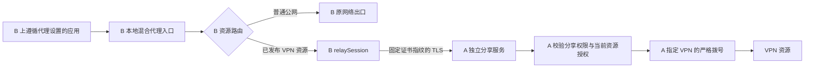

# 局域网分享：需求分析与实施计划

日期：2026-11-24。核对基线：`aTrustHub` 提交 `f3f7cf92a52f`（实现前已核对 `dev-main` HEAD 与该提交一致）。

状态：**已实现**（分支 `feat/lan-relay-sharing`，T01–T10），**未做跨机实机验收**。本文保留原始的需求与 UI/UX 判断；实际实现范围、验证证据与未验证项见文末「实施状态」以及 [详细实现方案](lan-relay-sharing-implementation-2026-11-24.md) §16。

详细开发契约、接口、生命周期及任务依赖见 [局域网分享：详细实现方案](lan-relay-sharing-implementation-2026-11-24.md)。产品入口名称统一为“局域网分享”，启停按钮使用“开启共享”“关闭共享”。

## 1. 建议先确定的产品行为

首版定位为“把 A 已获授权的 VPN 资源分享给 B”，默认由 B 本机分流：

| B 的请求 | 默认路径 | A 断开或撤销分享后 |
| --- | --- | --- |
| A 发布且当前授权的资源 | B 本地入口 → 加密中继 → A → 指定 VPN | 拒绝新连接并结束对应中继连接，不自动改走公网 |
| 普通公网目标 | B 本地入口 → B 原网络 | 继续使用 B 原网络 |
| 已知受管资源，但端口/协议未授权 | 拒绝 | 继续拒绝 |
| 同时属于多个不等价网关的资源 | 复用现有冲突提示，要求明确选择 | 不随机换网关 |

这里的“资源”由网关资源快照及授权规则确定，不等于全部 `10/8`、`172.16/12`、`192.168/16`。VPN 资源也可能采用其他地址或域名。

公网通过 A 出口可以后续作为单独的“共享主机出口”能力评估；首版不隐含开启。“所有应用/所有协议都被接管”则属于透明接管能力，不能用系统代理开关代替验收。

首版建议同时只运行一个分享会话，绑定一个本机已在线、具备严格拨号能力的 VPN 接入点；默认选择当前使用的接入点。需要分享其他网关时，先关闭当前分享再选择新网关开启，不将多个网关的规则简单合并；多会话并发分享后续评估。首版不允许继续分享 `lan_relay` 节点，避免中继成环。

共享范围固定为整个所选接入点，不提供资源树勾选、资源子集、分享专用端口/域名白名单或逐资源授权。接入点原有授权和停用策略继续生效；底层资源快照只服务于分流、授权与 DNS，并随该接入点变化自动同步，不作为用户需要额外配置的共享维度。

### 1.1 用户补充约束：首次默认关闭，手动开启后跨重启恢复

- 首次安装及旧配置缺少设置时，共享默认关闭。只有用户明确点击“开启共享”才持久化启用意图；未开启前，登录 VPN、恢复系统代理、打开面板或修改草稿均不产生共享监听。
- 用户开启后记住 `Enabled=true`、所选接入点、地址端口和安全存储的共享身份。应用重启自动恢复此前已启用的共享，不要求再次点击；这不改变应用本身的开机启动设置。
- 区分持久化启用意图和实时运行状态。重启时所选 VPN 未连接，显示“共享已启用，等待接入点连接”；不自动替用户登录或修改 VPN 的 AutoConnect，待现有登录流程完成后恢复同一接入点。
- VPN 断开/重登、所选 LAN 地址消失或退出应用时，结束当前监听及连接但保留启用意图。原条件恢复后重新校验并恢复；凭据损坏、原端口占用或地址变化显示需处理，不静默换接入点/网络/端口。
- “关闭共享”明确保存 `Enabled=false` 并撤销口令，下次重启不恢复。关闭后再次开启生成新身份；普通应用重启保留原身份/IP/端口，已有口令在恢复成功后继续有效。
- B 端导入/连接与 A 端对外共享是独立动作。导入一个中继不会开启 B 的 LAN 监听，也不会自动修改 B 的系统代理；新导入节点的开机自动连接默认关闭。
- 剪贴板自动识别属于独立的可选体验，默认关闭；未开启时不在启动/聚焦时读取剪贴板。用户点击“粘贴口令”仍可正常手动导入。
- 托盘隐藏、关闭面板、主动关闭共享和真正退出应用的语义明确区分：前两者维持运行，退出停止本次服务但保留重启恢复意图，只有“关闭共享”禁用后续恢复。

## 2. 源码核对：可复用能力与缺口

以下路径均相对 `aTrustHub/`。

| 项目 | 已核对的现状 | 实施含义 |
| --- | --- | --- |
| 接入点模型 | `internal/model/model.go` 是 `AccessPoint`，已有独立 `Server`、`Port`，没有公开的 `Password` 字段 | 新增 `ProtocolLANRelay`；不能把 `IP:Port` 整体塞入 `Server`，也不把密码加进配置 JSON |
| 凭据 | `internal/store/store.go` 有 `SecretStore`、`PasswordKey`；`session_secrets.go` 支持写入失败时只保留内存 | B 的中继 token 走现有凭据接口；持久化失败必须显示“仅本次有效” |
| 协议分派 | `internal/vpn/easyconnect.go:NewProtocolConnector` 只识别 EasyConnect，其余落到 aTrust | 改为明确分派三种协议，未知值拒绝，不能让中继误走 aTrust 登录 |
| 会话扩展 | `manager.go` 有 `Connector`、`Session`、`StrictSession`、`SessionWatcher`；`dns.go` 有 `DNSExchanger` | 实现纯 Go `relaySession`，不需要额外外部 worker 进程 |
| 路由依据 | `internal/routing/routing.go:Decide` 使用资源快照、在线状态、严格能力、端口和协议；支持拒绝和归属冲突 | 一个普通 SOCKS5 dialer 不足以接入现有资源路由；还需要资源同步和远端严格授权 |
| 聚合入口 | `Manager.Aggregate()` 返回监听状态 `Endpoint`；`restartAggregate()` 把拨号交给 `m.Dial` | 这里没有“把 routing.Dialer 注册到 Aggregate()”的接口，应从 Session/Manager 接入 |
| 直连含义 | `internal/vpn/routing.go` 的 `direct` 分支在运行此 Manager 的机器调用 `originalRouteDial` | B 直接使用 A 的普通代理时，公网从 A 出；B 本机分流时，公网才从 B 出 |
| 资源更新 | Manager 连接成功时读取 `sess.Info()` 并缓存；`publishResourcesLocked` 应用停用资源过滤 | 更新 `relaySession.Info()` 本身不会自动刷新 Manager，需要受会话代次保护的更新入口 |
| 旧资源记忆 | `internal/vpn/resources.go:rememberResources` 保留历史归属，旧快照不授予权限 | 断线后保留已知归属，避免原先的 VPN 目标自动落入未知目标直连分支 |
| 监听范围 | `Settings.ListenHost` 同时控制每接入点代理和统一入口；更改会重启相关监听 | 新建独立的分享监听，不通过改这个全局设置实现分享 |
| 端口冲突 | `restartAggregate()` 明确拒绝静默换端口，防止系统代理及工具继续指向旧端口 | 既有本地入口保持此约定；新增分享入口可以用 `LAN_IP:0`，监听成功后公布实际端口 |
| 系统代理 | Windows 写 WinINET，当前 `ProxyServer` 仅配置 `socks=`；macOS 设置 HTTP/HTTPS/SOCKS；Linux 返回不支持 | 平台体验有差异；Windows 需要验证并评估配置本地 HTTP/HTTPS 代理项，Linux 首版提供本地端口和已有启动器 |
| 防断网 | `app.go:guardSystemProxy` 只检查 B 本地统一入口是否仍可连接 | 这不能检测 A 的 VPN 是否可用；中继需要独立健康状态和断开传播 |
| 恢复 | Windows 有原值/安装值 journal 和进程 Watchdog；macOS 有 Watchdog 和 bypass 快照 | macOS 尚非完整的原代理配置恢复，且恢复路径可能需要授权，不能承诺“永不残留断网” |
| 剪贴板与聚焦 | 当前 `app.go` 已调用 `mygo.Clipboard.Write`；工作区 MyGo 有 `Clipboard.Read`、`Window.OnFocus` | 首先核对应用实际依赖版本的 API，再接入启动/聚焦检查；手动粘贴始终可用 |
| 随机口令 | `model.NewProxyPassword()` 通常返回随机值，但随机源失败时退回时间字符串 | 新的分享凭据生成必须返回错误；随机源失败就中止开启，不能把时间值当安全口令 |

不要直接以旧说明文档替代源码：例如当前 macOS 已有 Watchdog 文件，而部分既有文档仍称只有 Windows 存在。

## 3. 原方案必须修正的推断

1. **系统代理覆盖的是遵循该设置的应用。** Git 的 HTTP 代理、Git SSH、包管理器、数据库驱动等需要分别验证。系统代理不是全系统 TCP/UDP 拦截。首版文案应写“支持系统代理的应用可直接使用；其他工具通过现有应用启动器或显式代理接入”。
2. **SOCKS5 认证不是链路加密。** RFC 1929 的用户名/密码协商本身是明文；Base64 只是编码。现场 Wi-Fi 不应仅凭一个强密码就被描述为安全的传输环境。
3. **创建 SOCKS5 dialer 不等于完成握手。** Go `proxy.SOCKS5` 构造连接器，实际建立连接发生在后续拨号；端口、认证、资源授权和 VPN 数据通路需要分层检查。
4. **连接失败不能只靠 ping 精确归因。** TCP 超时可能来自防火墙、AP 隔离、错误地址、路由或 VPN 的本地网络限制；主动拒绝也只能证明收到拒绝，不能唯一定位根因。
5. **热点不能保证 100% 互通。** 开热点、Wi-Fi 上联与下联并存、手机关闭蜂窝数据后的热点行为均受系统和设备影响；必须分别验证，不能承诺“免流量且必通”。
6. **关闭监听不必然关闭已建立连接。** 撤销分享必须同时取消拨号、关闭已接收连接和上游连接，并拒绝旧凭据。

## 4. 推荐架构



### 4.1 A：独立分享服务

- 监听选定的 LAN IPv4，首版不默认绑定所有网卡；本机统一代理和 worker 私有端口不变。
- 遍历活跃网卡和地址，结合接口属性及路由信息推荐候选，允许用户切换 Wi-Fi/有线/热点。仅靠接口名称黑名单不能可靠识别物理网卡。
- 首次开启生成并安全保存凭据和证书、成功绑定并持久化实际端口后再提供口令；自动端口 `0` 只用于首次分配，后续恢复复用原地址/端口，冲突时报需处理，不静默换端口。
- 每个运行实例绑定一个本机 VPN 接入点和发布代次，自动发布整个接入点已应用原有停用策略的有效快照，不新增分享专用筛选；不导出 VPN 登录凭据。
- 分享 token 使用至少 32 字节安全随机数，独立于 VPN 密码及已有代理密码。首版可由多名 B 共用一个会话 token，关闭/轮换统一撤销；逐客户端凭据和单独踢人可后续实现。
- 首次默认关闭；用户手动开启后持久化 Enabled、接入点和稳定身份，重启自动恢复。Running 只存在内存，不以旧运行状态代替就绪校验。应用退出不撤销长期口令，客户端租约仍为单次运行；不再采用“本次运行/24 小时后共享失效”的默认策略。
- 限制请求体、请求时间、并发连接及失败认证频率；只记录脱敏的客户端标识、源地址和错误类别。

### 4.2 传输与最小协议

推荐使用一个独立 TLS 端口提供版本化控制请求和 HTTP CONNECT 数据隧道，首版强制 HTTP/1.1，避免把 HTTP/2 CONNECT/Hijack 兼容性带入首个版本。无需另造 TCP/IP 栈，也无需新增外部进程。

| 能力 | 最小内容 |
| --- | --- |
| 认证握手 | 协议版本、分享 ID、token、服务端实例/会话代次、能力声明 |
| 资源获取 | 当前有效规则、域名声明、资源版本、有效期；不把 DNS 声明升级为端口授权 |
| 状态/更新 | A 的 VPN 状态、分享是否有效、资源版本；首版采用有界轮询，过期则断开 |
| TCP CONNECT | 原始域名/IP + 端口、分享会话代次及资源版本；A 校验后才返回成功 |
| DNS 查询 | 限定为当前分享网关声明的内部域名，复用会话 DNS 接口；不提供开放递归解析 |
| 错误 | 区分认证失败、分享撤销、版本不兼容、资源拒绝、VPN 离线、目标连接失败 |

TLS 使用分享口令携带的证书 SHA-256 指纹固定验证，不依赖把自签证书装进系统信任库。必须在发送 token 前完成指纹校验，不能无条件跳过验证或回退明文。口令只适合通过用户认可的渠道传递；它本身携带接入权限。

首版只声明 TCP 转发能力，不声明 UDP、ICMP、透明全机接管或免客户端系统代理兼容性。既有 worker IPC 继续用于本机进程；LAN 协议独立版本化，只复用经过验证的资源语义，不直接暴露本地 IPC。

### 4.3 A：必须新增严格的分享拨号边界

不能直接让分享服务调用普通聚合 `m.Dial` 或允许未受管目标直连的 `dialBound`。否则 B 请求一个公网目标，A 仍可能从自己的物理出口代为访问。

增加一个窄的 Manager 适配层，负责：

1. 验证分享仍有效、绑定网关仍是同一会话代次、当前在线且拥有严格拨号能力。
2. 校验目标属于有效发布范围，并以当前已过滤的资源快照重新判断端口/协议权限。
3. 只接受指向所绑定网关的严格 VPN 决策；任何 `direct`、冲突、未知或过期结果都拒绝。现有 A 本机 `direct` 策略不能变成分享服务的公网出口。
4. DNS 在绑定 VPN 会话内解析，最终业务连接继续严格校验解析结果；不把 B 发来的 DNS 结果视为可信授权。
5. 拨号完成后再次检查会话/分享代次，防止撤销和连接成功竞态；过期连接立即关闭。

### 4.4 B：实现原生中继会话

- 新增 `ProtocolLANRelay`，实现 `Session`、`StrictSession`、`SessionWatcher`，按能力实现 `DNSExchanger`/健康检查。
- `DialVPN` 只向 A 的已认证 TLS 服务提交严格 CONNECT；A 不可用、拒绝或返回过期状态时直接失败，不向 B 本机直连降级。
- 连接流程：TCP/TLS → 指纹 → 认证 → 获取有效资源 → 注册 Manager → 在线。状态页区分“已连上 A”与“VPN 业务已验证”。
- Manager 必须提供受 endpoint 身份和 generation 保护的资源更新机制，原子替换快照并刷新路由版本；旧响应不得覆盖重连后的会话。
- A 的资源变更时，首版可采用保守策略：提升资源代次并结束该分享下的旧业务连接，B 重取快照后恢复。以后再优化为只终止受影响连接。
- 中继失联/撤销后用 `SessionWatcher` 传播失效，保留 Known 归属用于阻止自动直连；已导入节点不等于可用节点。
- 当前 Known 归属主要保留在运行时，不能据此保证 B 重启后的安全行为。需要把已验证的历史归属以受限权限持久化，并在恢复系统代理前加载为“仅阻止自动直连”的归属缓存；缓存永远不授予拨号权限。首次导入尚未取得快照时，不为该分享宣告接管就绪。
- 不依赖主程序的“本地代理端口还在监听”来判断中继在线。B 本地统一入口可以继续运行，让公网按原网络直连。
- relay 控制/数据连接及 A 的 VPN 网关连接必须走原网络排除路径，避免系统代理或未来应用捕获造成递归代理。

### 4.5 DNS 的验收边界

SOCKS/CONNECT 请求保留原始域名时，由 A 在 VPN 内解析。只接收到 IP 时，只能按已有 IP 授权判断，不能猜测原始域名或扩大授权范围。

B 的系统 DNS、浏览器 DoH 和应用自行解析不是同一件事。首版验证支持代理远端解析的应用，并对提前本地解析导致的失败给出提示；若要覆盖“系统先解析的任意工具”，需要单独接入 split DNS/平台捕获，列入后续范围。不得通过删除所有私网绕过规则来声称 DNS 问题已经解决。

## 5. 数据模型与口令

`AccessPoint` 继续使用：`Protocol=lan_relay`、`Server=192.168.1.50`、`Port=<实际分享端口>`、`Name`、`InPool`、`AutoConnect`。新增 relay 专属的分享 ID、TLS 指纹、协议版本字段；不要复用语义不同的 VPN 网关证书例外字段。

中继 token 存在现有 SecretStore（B 可复用接入点密码键，A 使用独立共享身份键），不进入配置 JSON。A 的 `Settings.LANShare` 持久化 Enabled、PointID、接口/IPv4、配置端口/实际 BoundPort、ShareID 和指纹，不保存资源子集或 Running。历史资源归属缓存与当前授权快照区分存储和使用，缓存文件限制为当前用户可读写，删除节点时一并处理。Normalize/Validate、配置深拷贝、重启条件、删除凭据、编辑器协议分支和 UI 文案都要覆盖新协议，避免套用 aTrust 的 Radius、验证码、SSO、会话接管逻辑。

统一生成一种新口令，例如：

```text
connect-hub://relay/v1#<base64url-json>
```

载荷示意（以下是协议字段示意，不是有效凭据）：

```json
{
  "v": 1,
  "h": "192.168.1.50",
  "p": 23456,
  "sid": "<share-id>",
  "token": "<random-token>",
  "fp": "<sha256-fingerprint>",
  "name": "现场主机"
}
```

- Base64URL 使用无填充形式；复制文本与二维码使用同一载荷。选择 fragment 不能消除自定义 scheme/剪贴板/聊天记录泄密风险，完整口令仍是秘密。
- 首版 host 限定合法的 RFC1918 IPv4 单播地址；不接受 loopback、unspecified、multicast、任意 URL/path 或主机名。其他网段、IPv6 和跨网访问以后明确扩展。
- 限制总长度（建议 8 KiB）、字段长度、端口范围、token 长度、指纹格式和版本；严格拒绝重复关键字段及歧义输入。
- `hub://relay?...` 和旧 Base64 样例没有实际发布兼容义务时，不为它们引入明文降级。若发现实际已分发版本，再单列兼容适配，不推断 TLS 指纹。
- 口令不携带完整资源规则，实际规则在通过认证的 TLS 通道取得，避免过期和二维码膨胀。
- 同一分享按 `指纹 + 分享 ID` 去重，地址变更需要验证；不按名称合并，不默默覆盖另一节点的秘密。

## 6. 操作流程及跨平台差异

本节为待实施的 UI/UX 方案。复用现有 `view.go` 的接入点、原生模态框、设置分组、toast 和主题样式，不新增一级导航页。

### 6.1 功能入口与层级

| 位置 | 关闭时 | 开启后 |
| --- | --- | --- |
| 设置 → 网络与接管 | 增加“局域网分享”分组：未开启、简短用途说明、“开启共享…” | 启用/运行/等待状态、绑定接入点、管理共享、关闭共享 |
| 本机 VPN 接入点详情 | 次要动作“局域网分享…”；离线或缺少严格能力时说明不可用原因 | “管理共享”及运行/等待标记 |
| 主界面工具栏下方的轻量状态条 | 不占用常驻空间 | “局域网分享已开启 · 活跃客户端 N”及“管理”；最小窗口下仍可见 |
| 托盘菜单 | 可以保留“局域网分享…”管理入口 | 共享接入点及运行/等待状态，以及“关闭共享” |
| ＋接入点 | 在添加面板提供“VPN 接入点 / 同事分享”两种来源，默认仍为现有 VPN 表单 | 同一入口，不因主机分享状态变化而隐藏导入能力 |

简单模式同样可访问分享/导入入口，IP、端口、指纹等高级内容折叠。全局工具栏已有导航、接管方式、设置和添加按钮，不再追加常驻“分享”主按钮。

### 6.2 A：开启与管理共享

操作链路：“局域网分享…” → 选择接入点 → “开启共享” → 成功后“复制分享口令”。不叠加一个“启用功能”总开关，不展示资源选择步骤；一次开启即保存重启恢复意图。

开启前的面板：

| 内容 | 展示/交互 |
| --- | --- |
| 标题 | 局域网分享 |
| 当前状态 | 未开启 |
| 共享接入点 | 从接入点详情进入时预选该项；从设置进入时选择在线的本机 VPN 接入点 |
| 使用网络 | 例如“Wi-Fi · 192.168.1.50（推荐）”，多网卡可切换 |
| 范围说明 | “共享整个接入点，访问权限沿用该接入点；未受管公网使用同事自己的网络。”不提供资源勾选 |
| 生命周期说明 | “开启后将记住状态，应用重启自动恢复；接入点未连接时等待。点击关闭共享后不再恢复。” |
| 高级选项 | 端口：自动；需要时展开指定固定端口 |
| 底部动作 | 取消 / 开启共享 |

点击后显示“正在开启…”，禁用重复提交；首次开启中取消/关闭面板须回滚启用意图并清理已分配资源。失败保留用户选择并显示具体原因，允许重试。成功前不展示可复制口令或有效二维码；关闭查看自动恢复过程的管理面板不取消已保存的启用意图。

开启成功后，同一面板切换为管理状态：

- 标题显示“分享已开启”，同时明确“等待同事连接”或“活跃客户端 N”。这里的绿色只表示本机服务就绪，不提前宣称对方网络可达。
- 显示共享接入点、所选 LAN 地址、实际端口和“重启后自动恢复”；不展开逐资源共享控制。
- 主动作“复制分享口令”；次要动作“显示二维码”“连接诊断”。二维码按需展开，与复制口令携带相同权限；不额外暴露 VPN 密码。
- “关闭共享”使用独立的危险动作样式，与复制按钮分开；明确“关闭后不会在下次启动时恢复”。高级区可提供“更换口令并断开现有连接”，操作前明确影响。
- 关闭面板保持已启动的共享；面板内有“关闭此面板后共享继续，可在主界面或托盘停止”的简短说明。
- 活跃客户端数按认证后的控制会话/客户端实例及心跳租约统计，不以 TCP 连接数当人数。客户端实例标识不作为硬件身份或权限凭据；首版不显示无法可靠统计的“同事人数”。

VPN 暂时断开时关闭旧实例及连接，显示“共享已启用，等待接入点连接”，同一接入点重新就绪后自动恢复。原 LAN 地址暂时不可用则等待；地址发生变化、端口占用或凭据不可用时显示原因与“处理/重试恢复”。不自动改绑新网络；用户确认地址变化后更新口令并提示重新分发。等待/受阻状态仍提供“关闭共享”，无需先恢复运行才能禁用。

### 6.3 B：手动导入、连接与启用代理

默认路径：“＋接入点” → “同事分享” → 粘贴口令 → 本地解析预览 → “添加并连接”。仅在用户提交后请求 A；预览解析不发起网络请求。

预览展示节点名称、主机地址、分享来源指纹摘要及“VPN 资源走共享主机，公网走本机”。名称/IP 都是待校验信息，证书验证前不显示“主机可信”。不展示 aTrust/EasyConnect 的账号、登录域、验证码或 SSO 字段。

连接进度逐步显示“连接共享主机 → 验证身份 → 获取资源”；连接和资源同步完成后，定位到新建的接入点卡片，并按真实状态显示：

- 接入点类型：局域网中继；来源：现场主机；地址：IP:端口。
- “已连接共享主机 / 资源已同步”与“VPN 业务待验证 / 资源访问已验证”分开呈现；单个业务目标失败不等同于 A 完全离线。
- Windows/macOS 当前未接管时，提示“已连接。开启系统代理后，支持系统代理的应用即可使用”，提供显式“开启系统代理”按钮。沿用现有接管切换、冲突和授权流程。
- 已有系统代理或其他接管方式生效时显示当前实际状态，不重复接管或覆盖第三方设置；尚未支持的 relay 透明接管路径不宣传为可用。
- Linux 提供“复制本地代理地址”和已有启动器入口，说明此平台当前没有系统代理托管。
- 新节点默认不开启启动自动连接；“添加并连接”仅授权本次连接。后续需要自动连接时由用户在节点设置中另行开启。

可选增强为“自动识别剪贴板中的分享口令”，默认不勾选，置于导入面板/相关设置。用户明确开启后，才在启动/聚焦时读取有限长度文本，并显示非模态提示：

> 检测到分享口令：现场主机（192.168.1.50）。[查看并连接] [忽略]

“查看并连接”先进入同一预览面板，用户确认提交后才连接。忽略按内容摘要去重；已导入同一分享时提示“打开现有节点”，避免重复创建。不持续后台监听剪贴板，不把完整文本写日志，也不自动改变接管方式。

### 6.4 状态与错误反馈

| 状态 | 主要文字 | 用户动作 |
| --- | --- | --- |
| A：关闭 | 未开启局域网分享 | 开启共享… |
| A：准备中 | 正在开启共享… | 首次开启可取消，禁止重复开启 |
| A：恢复中 | 正在恢复共享：接入点名称 | 查看进度 / 关闭共享 |
| A：服务就绪 | 分享已开启 · 等待同事连接 | 复制口令 / 诊断 / 关闭 |
| A：存在客户端 | 分享已开启 · 活跃客户端 N | 管理 / 关闭 |
| A：停止中 | 正在停止共享… | 停止复制/展示运行口令，等待资源清理 |
| A：等待 | 共享已启用，等待接入点连接/原网络就绪 | 连接接入点 / 关闭共享 |
| A：恢复受阻 | 共享已启用，暂未运行：具体原因 | 处理 / 重试恢复 / 关闭共享 |
| B：连接中 | 连接主机/验证身份/获取资源 | 取消 |
| B：可用 | 共享主机已连接 · 资源已同步 | 显式启用代理或打开已有工具 |
| B：暂时失联 | 暂时无法连接共享主机，正在重试 | 有界重试 / 手动重连 / 诊断 |
| B：已撤销 | 分享已关闭或口令失效，请向主机获取新口令 | 更新口令；停止对旧凭据的自动重试 |
| 系统设置恢复失败 | 系统代理尚未恢复，需处理 | 重试恢复 / 查看操作说明，保留恢复记录 |

主机状态和 B 的网络接管状态独立展示。颜色同时配文字和图标，不以单独绿点代表整条 VPN 业务链路成功。复制成功使用 toast；持续失败、撤销和待恢复问题保留在卡片或状态条，不只闪现通知。

连接诊断先显示“主机地址是否可达、身份/认证、资源同步、VPN 业务”各阶段。使用“未连接成功，可能是防火墙或网络隔离”等诚实文案，不把超时直接标成“防火墙未放行”。涉及防火墙修改时单独提供“允许局域网连接”动作及平台授权，不在开启共享时静默改规则。

### 6.5 关闭、退出与口令失效

- 无活跃客户端时，“关闭共享”直接执行；有活跃客户端时只确认一次：“将中断 N 个活跃客户端的资源访问，当前口令立即失效，下次启动不再恢复。”关闭同时保存 Enabled=false；保存失败仍停止当前服务并明确提示重启可能恢复，提供重试保存，不能显示已永久禁用。
- 关闭必须等待监听、待处理拨号和已有连接清理完成，成功后才显示“已关闭”；清理未完成保持“关闭中/需处理”，不能虚报关闭。
- 真正退出应用时复用已有退出确认，必要时说明“本次连接将断开，下次启动自动恢复共享”；不清除 Enabled、不撤销长期身份，不连续叠加两个确认框。
- 关闭主窗口若按现有设置隐藏到托盘，共享保持运行；首次发生时提示“已移至托盘，局域网分享仍开启”，托盘始终可停止。若主窗口关闭即退出，则按真正退出处理。
- 明确关闭后再开启/主动更换口令才生成新身份，旧口令不能复用；普通应用重启复用身份和地址端口，客户端需重新认证。原生操作系统拒绝设置或恢复失败时显示真实结果，不把系统弹窗取消当作成功。

### 6.6 平台差异及工具覆盖

| 平台 | 首版基础接入 | 系统代理/恢复的发布条件 |
| --- | --- | --- |
| Windows | B 本地 SOCKS5/HTTP 入口 | 验证浏览器 HTTP/HTTPS 实际使用本地入口；评估补齐 WinINET HTTP/HTTPS 配置；journal、第三方代理所有权和 Watchdog 实机通过 |
| macOS Intel/Apple Silicon | B 本地 SOCKS5/HTTP 入口 | 逐服务快照原代理地址/开关/认证状态/bypass；持久化成功才修改；检查命令退出码与读回；拒绝授权时保留恢复记录并显示待恢复 |
| Linux | B 本地 SOCKS5/HTTP 入口和现有工具启动器 | 当前不宣称有系统代理开关；后续按桌面环境单独实现，或另行接入已有应用捕获 |

对“全场景”工具单列浏览器、Git HTTPS、Git SSH、curl、Maven/Gradle、数据库连接的验证结果。需要额外配置的工具通过现有启动器/明确指引接入，不用一个系统代理绿灯代表所有工具成功。

### 6.7 UI 验收条件

- 默认配置、旧版本升级及 Enabled=false 时，重启/VPN 自动登录/打开面板均没有新 LAN 分享监听。手动开启并保存后重启应恢复同接入点、身份、地址端口；未登录时显示等待，明确关闭后重启不恢复。
- 共享范围只有接入点选择，不出现资源勾选或额外资源授权；接入点当前有效权限整体共享并随源变化。测试原有权限/停用策略仍生效。
- 剪贴板自动识别默认关闭；未勾选时启动和聚焦不会读取剪贴板；手动粘贴入口一直可用。
- B 导入节点不隐式开启 B 对外分享或系统代理；新节点自动连接默认关闭。
- 分享运行时，即使管理面板关闭，主界面/托盘仍可看见状态并停止；主界面至少保留一个可定位的管理入口。
- 复用现有主题、字号层级和控件；720×520 等最小窗口下可完成开启、复制和停止。窄窗口二维码与详情纵向排列，面板内容可滚动，主要操作可见。
- 简单模式下无需切到专业设置即可完成分享/导入；长名称、长地址、大字号、深浅主题和键盘焦点均检查。
- 连点开启/关闭、开启过程中取消、重复导入、网络变化与对话框同时出现时不产生重复服务、误导状态或残留有效口令。

## 7. 端口不可达时的处理

诊断分层展示已确认事实及可能原因：

| 阶段 | 可确认的事实 | 建议动作 |
| --- | --- | --- |
| 口令解析失败 | 格式或版本不受支持 | 重新复制当前版本口令 |
| TCP 拒绝 | 收到连接拒绝 | 检查 A 是否开启共享且正在运行、地址端口是否变化，再检查防火墙 |
| TCP 超时/无路由 | 在期限内未建立连接，原因未唯一确定 | 核对双方网络、A 选中的地址、AP 隔离、防火墙及 VPN 本地网络限制 |
| TLS/指纹错误 | 对端身份不匹配或 TLS 无法建立 | 停止发送凭据，重新从 A 获取口令 |
| 认证失败/撤销 | 无有效分享权限 | 获取新口令，不无限重试旧 token |
| 资源同步成功、业务失败 | A 可达，故障在权限、DNS、VPN 或业务端口 | 展示 A 的 VPN 状态及本次目标错误 |

Windows 的“放行”按钮应当在用户明确操作及系统授权后，创建仅针对本程序、实际端口、所选网络范围的最小规则。建议默认 Private + 所选 LAN 子网；Public 网络需要显示实际限制，不能静默改网络类别或放开所有来源。删除/崩溃恢复只操作自己记录 ID 的规则，不碰既有规则。

macOS 不照搬 Windows 端口规则；根据系统现有应用防火墙设置提供检查指引。Linux 根据实际发行版/firewalld/nftables 环境说明，不默认改整套规则。

如果是客户端隔离或双方没有可达网络，本地应用不能凭空打通。可建议有线/受允许且验证可互通的热点；若产品必须覆盖跨网或强隔离，另立覆盖网络/反向中继方案，明确额外服务依赖、加密和部署条件，不纳入本次 LAN 首版。

## 8. 实施顺序与验收门槛

| 阶段 | 工作内容 | 主要文件（建议新增文件尚不存在） | 完成标准 |
| --- | --- | --- | --- |
| P0：确认边界与验证风险 | 固定接入点级共享、手动开启后重启恢复、单网关会话和 TCP 范围；验证平台代理/网络；冻结 LAN v1 协议 | 本计划、协议说明及平台验证记录 | 记录每个平台可承诺范围，启用意图/运行态、身份持久化、TLS、严格拨号和撤销有明确契约 |
| P1：模型和口令 | 新协议、专属元数据、凭据存储、Normalize/Validate、解析器、版本/大小限制、去重、日志脱敏 | `internal/model/model.go`、`internal/store/`、新增 `internal/relay/sharecode.go` | 无网络导入测试通过，旧 VPN 配置行为不变，随机源失败不开共享 |
| P2：最小端到端中继 | 独立 TLS 服务、资源 API、严格分享拨号、纯 Go Session、Manager 更新、状态和关闭传播 | 新增 `internal/relay/{protocol,server,client}.go`、`internal/vpn/{relay,relay_share}.go`，修改 `easyconnect.go`、`manager.go` | 无 UI 情况下完成 B→A→授权资源；B 公网本机直连；A 拒绝公网/越权；撤销关闭存量连接 |
| P3：一键分享及导入 | 首次默认关闭、手动开启后重启恢复、整接入点选择、网卡/稳定端口、二维码、复制、导入、可选剪贴板、等待状态和关闭入口 | 新增 `lanshare.go`、`import_relay.go`，修改 `app.go`、`view.go` | A 开启并复制、B 添加并连接；A 重启恢复、离线等待、明确关闭后不恢复；不隐式开启 B 系统代理；满足 §6.7 |
| P4：平台接管与网络诊断 | Windows 代理兼容修正、macOS 恢复补齐、工具兼容说明、连通性体检、按需防火墙指引/规则 | `systemproxy_*.go`、`systemproxy_journal*.go`，新增 `internal/relay/diagnose.go` 及平台适配 | 通过目标应用、崩溃恢复、第三方代理共存及权限拒绝实机矩阵 |
| P5：发布验收 | 多人并发、弱网/休眠、IP 变化、VPN 重登、资源撤回、凭据轮换、混合节点冲突、平台打包 | 相关回归测试、平台验收记录、实际功能文档 | 通过下列验收矩阵；未验证能力不能写成已支持 |

P0 → P1 → P2 是核心依赖顺序。可以在 P2 通过后交付开发者预览版；面向普通同事的“一键使用”需要 P3/P4 完成。不要先做分享弹窗，再尝试给缺少资源语义的 SOCKS dialer 补授权。

### 核心验收矩阵

- **路由**：域名/IP、端口拒绝、不同私网、同网段冲突、域名解析后授权、用户策略冲突；确认 B 公网的实际出口是 B。
- **授权**：无 token、错误 token、旧 token、错误证书、过期代次、只命中 DNS 声明、伪造资源请求均不能得到未授权连接；A 不提供普通公网转发。
- **生命周期**：主动关闭共享后重启不恢复，A 退出/强杀后重启恢复原身份，VPN 下线/重登后重新绑定同一接入点新代次，以及 B 强杀、断网/恢复、休眠/唤醒和接口切换；晚到响应不得复活旧运行实例。特别验证 B 重启且 A 不可达时，历史受管目标仍不会自动直连。
- **持续连接**：上传/下载、SSH、数据库长连接、半关闭、并发取消；撤销确实关闭已有两端连接，没有 goroutine/文件描述符持续增长。
- **系统恢复**：原先已有代理、第三方中途修改、权限被拒、Watchdog 启动失败、恢复命令失败/部分成功；失败保留可重试记录，不虚报恢复完成。
- **兼容**：至少覆盖 Windows↔Windows、Windows↔macOS、Linux↔Windows/macOS；CPU 架构组合按实际发布包实测，交叉编译不代表实机通过。
- **规模**：先按 5–10 名现场同事验证，记录连接数、持续下载吞吐、CPU/内存与目标故障隔离，再决定正式支持人数。
- **导入**：超长/损坏/重复字段输入、重复聚焦、忽略后再次聚焦、口令过期、名称中的特殊字符；完整口令不出现在日志和错误上报。
- **启用恢复与交互**：执行 §1.1 与 §6.7；未开启时重启不监听，用户开启后重启恢复同接入点/身份/IP/端口，离线等待，主动关闭后不恢复；范围只按接入点。剪贴板识别需先选择开启，B 导入不隐式开启系统代理或对外分享。

### 功能范围暂缓项

首版暂缓：公网经 A 出口、多级中继、无客户端认证代理接入、UDP/ICMP、任意应用透明接管、跨公网穿透、手机原生接入、逐同事单独授权/踢人。它们不是在当前三个阶段旁边补几个按钮就能保证完成的能力，应各自定义验收。

## 9. 实施状态

### 9.1 已落地的部分

- 模型：`ProtocolLANRelay`、`RelayPointOptions`、`Settings.LANShare`、`RelayClipboardDetection`（默认关闭）；relay 节点不进入 aTrust 的 Radius/登录模式补全，`needsRestart` 比较分享身份但不比较历史标记。
- 口令：`connect-hub://relay/v1#<base64url-json>` 的唯一生成路径，严格解析（重复/未知键、尾随 JSON、类型、溢出、非 RFC1918、控制字符、长度上限）。
- A：独立 TLS 1.3 端口、固定指纹、严格出口（direct/未知/冲突/旧 TUN 一律拒绝）、整接入点范围、租约与限流、独立连接登记（关闭 Hijacked 连接）、Enable/Restore/Waiting/Blocked/Disable/Shutdown。
- B：`lan_relay` 协议分派、固定指纹的 TLS、`relaySession`（Session/StrictSession/Watcher/Updater/DNSExchanger）、租约心跳、历史归属缓存与「未知目标不得静默直连」门控。
- UI：「局域网分享」设置分组、开启/关闭共享面板、状态条、托盘入口、同事分享导入（本地预览、指纹+分享 ID 去重、AutoConnect=false、不改系统代理）、分层诊断。

### 9.2 尚未落地或未验证

- 二维码渲染、「更换口令」按钮（当前为禁用占位）、剪贴板自动识别（默认关闭且未接线）。
- Windows 防火墙最小规则工具已写但未实机执行；macOS/Linux 只有指引；系统代理平台实现未改动。
- §8 的全部实机门槛、规模与工具矩阵均未执行。

## 10. 本次验证与后续工作

实现前的基线测试（历史基线，不代表新功能）：

```text
go test ./internal/model ./internal/routing ./internal/proxy ./internal/store ./internal/vpn
```

这些结果只验证当时已有模块的测试通过。实现后的测试结果、竞态检查、交叉编译结论与未验证项见 [详细实现方案](lan-relay-sharing-implementation-2026-11-24.md) §16。实现过程没有修改系统代理、防火墙或运行中的 VPN。

进入开发时，第一批可交付内容应为 P1 以及 P2 的协议/严格拨号接口骨架和测试；不要仅添加 `ProtocolLANRelay` 与普通 SOCKS5 dialer 就宣告 Phase 1 完成。

外部约束参考：RFC 1929 §3（认证明文）、Go `golang.org/x/net/proxy` 文档及 SOCKS5 源码、Git `git-config` 的 `http.proxy`/`core.gitProxy`、Microsoft 的 WinINet/WinHTTP 比较与防火墙规则文档、Apple 的 Mac Internet Sharing 用户指南。具体已实现行为以前述仓库基线源码为准。
